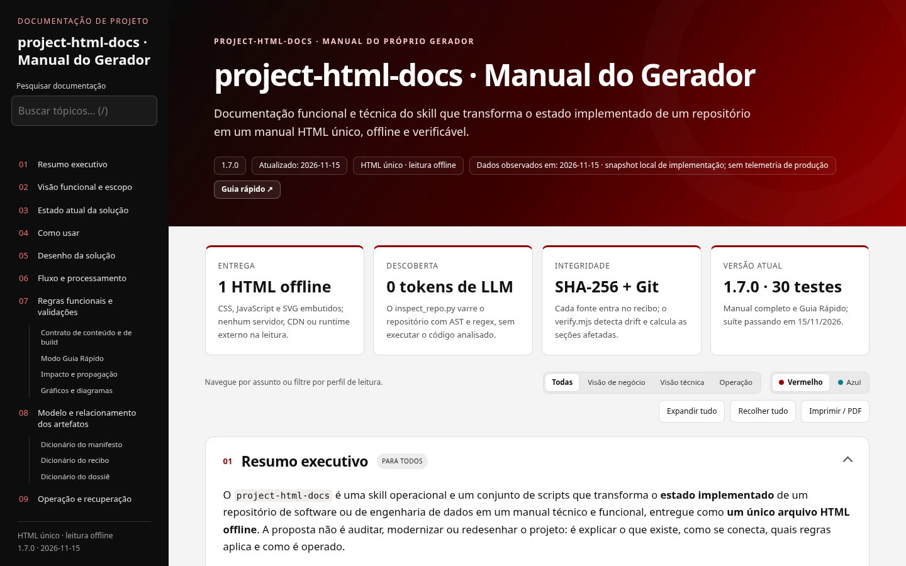

# project-html-docs

<p align="center">
  <strong>Transforme o código implementado do seu repositório em um manual técnico único, offline, interativo e matematicamente verificável.</strong>
</p>

<p align="center">
  <a href="https://nodejs.org/"></a>
  <a href="https://www.python.org/"></a>
  <a href="https://github.com/alebitencourtx/project-html-docs/actions/workflows/ci.yml"></a>
  <a href="https://alebitencourtx.github.io/project-html-docs/"></a>
  <a href="CHANGELOG.md"></a>
  <a href="LICENSE"></a>
</p>

<p align="center">
  <a href="https://alebitencourtx.github.io/project-html-docs/"><strong>🌐 Landing Page Oficial</strong></a> •
  <a href="https://alebitencourtx.github.io/project-html-docs/documentacao.html"><strong>📖 Manual Completo</strong></a> •
  <a href="https://alebitencourtx.github.io/project-html-docs/documentacao-resumida.html"><strong>⚡ Guia Rápido</strong></a> •
  <a href="https://github.com/alebitencourtx/project-html-docs/releases/latest"><strong>📦 Baixar Skill ZIP</strong></a>
</p>

---

<p align="center">
  <a href="https://alebitencourtx.github.io/project-html-docs/">
    
  </a>
</p>

---

## Por que project-html-docs?

A maioria das documentações técnicas sofre de dois problemas crônicos: dependem de infraestrutura pesada (servidores, CDNs, wikis lentas) e ficam desatualizadas semanas após o lançamento. O `project-html-docs` resolve isso unindo **automação AST local**, **visual refinado de produto** e **integridade criptográfica**.

| 🔒 **100% Offline & Seguro** | 🧠 **Descoberta AST sem Tokens** | 🎨 **Diagramas Vetoriais 2D** | 🛡️ **Zero Drift Verificável** |
| :--- | :--- | :--- | :--- |
| HTML único com CSS, JS e SVGs embutidos. Zero requisições externas, zero CDNs e compatível com ambientes corporativos isolados. | Script Python que mapeia PySpark, Databricks, SQL, ADF e APIs via AST local, sem gastar tokens de LLM na varredura. | Motor nativo de arquitetura (`solution`) e modelagem de tabelas (`schema`) com desvio de rótulos e temas sincronizados. | Recibo `validation.json` com hashes SHA-256 de todas as fontes. O `verify --impact` aponta apenas o que mudou. |

---

## ⚡ Quickstart em 30 segundos

### 1. Baixar e instalar na pasta de skills da sua IDE/CLI

```bash
# Baixe a release enxuta oficial (ou clone o repositório)
mkdir -p .claude/skills/project-html-docs
unzip project-html-docs-v1.12.0.zip -d .claude/skills/project-html-docs
npm ci --ignore-scripts --prefix .claude/skills/project-html-docs

# Verifique o ambiente (Node >= 22 e Python >= 3.10)
node .claude/skills/project-html-docs/scripts/cli.mjs doctor
```

### 2. Testar imediatamente com os exemplos inclusos

```bash
# Compilar exemplo funcional mínimo (1 HTML de saída)
npm run build:example

# Compilar exemplo completo com as 11 seções e diagramas avançados
npm run build:showcase
```

Abra o arquivo gerado `examples/showcase/documentacao.html` diretamente em qualquer navegador!

---

## 🔄 Fluxo de trabalho

```text
┌────────────────────────┐      ┌────────────────────────┐      ┌────────────────────────┐      ┌────────────────────────┐
│  1. INSPECT (AST)      │ ───► │  2. MANIFESTO & MD     │ ───► │  3. BUILD (1 HTML)     │ ───► │  4. VERIFY & IMPACT    │
│  Varre código, SQL,    │      │  document.json         │      │  Gera HTML offline     │      │  Gera recibo SHA-256   │
│  notebooks e gera      │      │  + content.md com      │      │  com temas Vermelho/   │      │  e calcula impacto     │
│  roteiro de leitura    │      │  seções e diagramas    │      │  Azul e busca local    │      │  de novos commits      │
└────────────────────────┘      └────────────────────────┘      └────────────────────────┘      └────────────────────────┘
```

### 1. Inspecionar o código do repositório
Descubra a topologia do projeto e monte um roteiro estruturado de leitura em 4 ondas ordenadas:
```bash
node scripts/cli.mjs inspect <caminho-do-repositorio> --out docs/inventory.json --plan docs/reading-plan.md
```

### 2. Estruturar o documento
Crie o manifesto com metadados e vincule cada capítulo aos arquivos de código reais:
- **`document.json`**: Metadados (título, autor, tema, idioma, seções e fontes declaradas).
- **`content.md`**: Conteúdo técnico em Markdown com títulos `## H2` correspondentes, tabelas e diagramas.

### 3. Compilar em HTML único
```bash
# Modo Manual Completo (jornada exaustiva)
node scripts/cli.mjs build docs/document.json --out docs/documentacao.html --force

# Modo Guia Rápido (visão executiva para leitura em ~5 minutos)
node scripts/cli.mjs build docs/document-summary.json --out docs/documentacao-resumida.html --mode summary --force
```

### 4. Validar integridade e acompanhar mudanças
```bash
# Verifica se os arquivos de código divergem do que foi documentado
node scripts/cli.mjs verify docs/document.json docs/documentacao.validation.json --strict

# Review visual via Chrome/Edge/Chromium instalado (desktop 1440 px por padrão)
node scripts/cli.mjs review docs/documentacao.html --out tests/.output/review

# Após abrir cada PNG e preencher a rubrica retornada pelo review
node scripts/cli.mjs verify docs/document.json docs/documentacao.validation.json --strict --mark-reviewed --rubric <caminho-da-rubrica>

# Analisa o impacto de um novo commit e gera plano cirúrgico de atualização
node scripts/cli.mjs verify docs/document.json docs/documentacao.validation.json --impact --dossier docs/inventory.json --plan docs/update-plan.md
```

O review não baixa navegador nem adiciona dependências npm. Use `--viewports 1440,1024,390` para incluir tablet/mobile e `--tiles all` para capturar todas as seções e o tema Azul. Consulte o [fluxo de revisão visual](references/visual-review.md) para os checks, a rubrica e exceções explícitas via `--accept-issues`. Os scripts npm de desenvolvimento (`test`, `build:showcase`, `package:skill`) destinam-se ao clone completo; no ZIP enxuto, use a CLI.

---

## 🎨 Recursos de interface e ergonomia de leitura

- **Temas integrados**: Alternância dinâmica entre **Vermelho** (padrão) e **Azul**, sincronizando o layout e as paletas dos diagramas.
- **Navegação responsiva inteligente**:
  - Desktop: Barra lateral flexível com rolagem independente e subnavegação automática para títulos `H3`.
  - Mobile (≤ 960 px): Drawer off-canvas acessível (`inert`, focus trap, fechamento por `Esc` ou seleção de capítulo).
- **Filtro por perfil de leitor**: Alternância instantânea entre *Todas*, *Visão de negócio*, *Visão técnica* e *Operação*.
- **Busca local instantânea**: Localiza qualquer termo no documento com atalhos de teclado (`/` ou `Ctrl+K`) e realce visual.
- **Rolagem uniforme e livre**: Tabelas expandidas na altura natural com rolagem horizontal contínua (`.table-wrap`), sem travamentos de roda de mouse.
- **Filtro dinâmico em tabelas**: Campo de busca automática em tabelas e dicionários de dados com mais de 8 linhas.
- **Formatadores semânticos**: Callouts automáticos para regras de negócio, exemplos práticos e avisos.

---

## 📊 Diagramas 2D em SVG nativo

Escreva arquiteturas e modelos diretamente no Markdown usando blocos JSON tipados:

### Arquitetura em zonas (`solution` ou `flow`)

````markdown
```solution
{
  "title": "Fluxo de Ingestão e Processamento",
  "cols": 3,
  "zones": [
    { "id": "z1", "title": "INGESTÃO", "subtitle": "Streaming contínuo", "variant": "warm", "row": 0, "colStart": 0, "colSpan": 3 },
    { "id": "z2", "title": "PERSISTÊNCIA", "subtitle": "Armazenamento analítico", "variant": "cool", "row": 1, "colStart": 1, "colSpan": 2 }
  ],
  "nodes": [
    { "id": "fonte", "col": 0, "row": 0, "role": "danger", "title": "Azure Event Hubs", "lines": ["telemetria"] },
    { "id": "job", "col": 1, "row": 0, "role": "step", "step": 1, "title": "Structured Streaming", "lines": ["watermark 15m"] },
    { "id": "delta", "col": 1, "row": 1, "shape": "cylinder", "role": "info", "title": "Delta Lake Bronze", "meta": "ADLS Gen2" }
  ],
  "edges": [
    { "from": "fonte", "to": "job", "label": "eventos" },
    { "from": "job", "to": "delta", "label": "grava lote" }
  ]
}
```
````

### Tabelas e linhagem de dados (`schema` ou `erd`)

````markdown
```schema
{
  "title": "Modelagem de Tabelas e Linhagem",
  "entities": [
    {
      "id": "t_origem",
      "name": "raw_events",
      "kind": "table",
      "grain": "1 linha = 1 evento",
      "col": 0, "row": 0,
      "columns": [
        { "name": "event_id", "type": "STRING", "key": "PK" },
        { "name": "device_id", "type": "STRING", "key": "FK" },
        { "name": "data_particao", "type": "DATE", "key": "PART" }
      ]
    },
    {
      "id": "t_destino",
      "name": "fct_metrics_daily",
      "kind": "mart",
      "grain": "1 linha = 1 dispositivo/dia",
      "col": 1, "row": 0,
      "columns": [
        { "name": "data_referencia", "type": "DATE", "key": "PK" },
        { "name": "total_eventos", "type": "BIGINT" }
      ]
    }
  ],
  "relations": [
    { "from": "t_origem", "to": "t_destino", "fromCard": "1", "toCard": "1..N", "kind": "lineage", "label": "agregação" }
  ]
}
```
````

---

## 📂 Estrutura do projeto

```text
project-html-docs/
├── .github/
│   ├── scripts/package_skill.py # Empacotador determinístico do ZIP de release
│   └── workflows/              # CI multiplataforma e publicação automática de release
├── agents/                     # Metadados de integração para agentes de IA
├── assets/                     # CSS, JS, temas (Vermelho/Azul) e interatividade offline
├── docs/                       # Landing page e manuais compilados (GitHub Pages)
│   ├── index.html              # Landing page interativa bilíngue (PT/EN)
│   ├── documentacao.html       # Manual completo do próprio gerador
│   └── documentacao-resumida.html # Guia rápido do próprio gerador
├── examples/                   # Exemplos funcionais (minimal e showcase completo)
├── references/                 # Manuais técnicos de autoria, engenharia de dados e diagramas
├── schemas/                    # Validação JSON Schema estrita para documentos e diagramas
├── scripts/                    # CLI única (cli.mjs), build, inspect, validate e verify
└── tests/                      # 55 testes automatizados (unitários, contratos e Chromium headless)
```

---

## 🧪 Testes e garantia de qualidade

A suíte cobre contratos de schema AJV, renderização determinística de diagramas 2D, navegação WAI-ARIA, integridade de URLs e testes reais em Chromium headless:

```bash
# Rodar todos os 55 testes automatizados
npm test
```

---

## 📜 Histórico de releases & Licença

- Confira o histórico completo de novidades e melhorias em [CHANGELOG.md](CHANGELOG.md).
- Distribuído sob [licença MIT](LICENSE).
