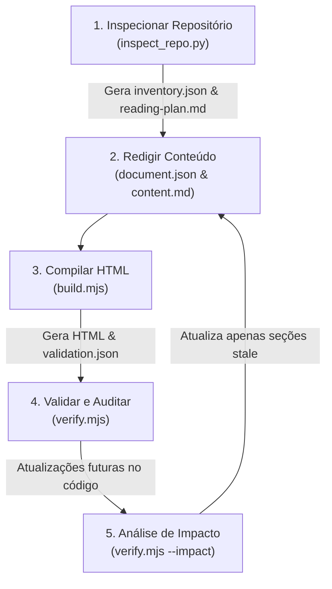

# project-html-docs 📚⚡

> **Gerador de Documentação Funcional e Técnica de Projetos em HTML Único, Interativo e 100% Offline.**

[](https://nodejs.org/)
[](https://www.python.org/)
[](#testes-automatizados)
[](CHANGELOG.md)
[](LICENSE)

O **`project-html-docs`** é uma skill e ferramenta de engenharia documental projetada para transformar o estado implementado de qualquer projeto de software ou esteira de engenharia de dados (pipelines, lakehouses, APIs, orquestrações) em um **manual interativo compilado em um único arquivo `.html` estático**. 

O leitor final precisa apenas de um navegador moderno — sem servidores web, sem dependências de rede, sem CDNs externas e sem banco de dados.

---

## 🎯 Por que o project-html-docs?

- **📦 100% Autocontido e Offline**: Todo o CSS, JavaScript e diagramas SVG são embutidos diretamente no HTML final. Ideal para ambientes corporativos fechados, intranets bancárias, anexos de auditoria e conformidade regulatória.
- **🎨 Temas Nativos (Padrão & Santander)**: Alternância em tempo real entre o tema clássico (azul/petróleo) e a identidade visual Santander (vermelho institucional), com persistência no `localStorage`.
- **🧩 Motor SVG 2D Nativo (`diagrams.mjs`)**: Criação determinística de diagramas de arquitetura em grade 2D (`solution`) e modelos de dados com linhagem (`schema`) diretamente no Node.js, com *bypass routing*, *self-loops* e conectores *Crow's Foot*.
- **🔎 Leitura e Usabilidade Avançada**:
  - **Filtro de Perfil de Leitura**: botões *Todas*, *Visão de negócio*, *Visão técnica* e *Operação* sem perda de contexto.
  - **Busca Instantânea**: destaque visual de termos encontrados (`<mark>`), atalhos de teclado (`/` e `Ctrl+K`) e botão de limpar.
  - **Filtro Dinâmico em Tabelas**: tabelas com 8 ou mais linhas (inclusive em `<details>`) recebem campo de pesquisa rápida local.
  - **Badges e Callouts Tipados**: destaques semânticos para `PK`, `FK`, `UK`, `PARTIÇÃO`, `PII` e blocos de regras de negócio.
- **⚡ Descoberta Estática Profunda (Zero Tokens de LLM)**: O `inspect_repo.py` usa AST e análise de código para mapear PySpark, Databricks, Delta Lake, Cosmos DB, Event Hubs, ADLS Gen2, APIs e gerar um plano cirúrgico de leitura (`reading-plan.md`) dividido em 4 ondas.
- **🛡️ Rastreabilidade e Análise Incremental de Impacto**: O `verify.mjs` utiliza hashes SHA-256 e o grafo de dependências para identificar alterações no repositório e indicar exatamente quais seções do documento precisam ser revisadas (`--impact`).

---

## 📂 Estrutura do Repositório

```text
project-html-docs/
├── assets/
│   ├── document.css            # Estilos, variáveis de tema (Padrão/Santander) e ergonomia visual
│   └── document.js             # Busca, highlight, filtro de perfis, tema e controles de zoom
├── examples/
│   ├── minimal/                # Exemplo conciso inicial (document.json + content.md)
│   └── showcase/               # Exemplo demonstrativo completo com as 11 seções e diagramas 2D
├── outputs/
│   └── admin-metrics-v2/       # Estudo de caso de esteira de dados
├── references/
│   ├── authoring.md            # Guia completo de autoria, estrutura e sintaxe
│   ├── data-engineering.md     # Diretrizes e checklists para engenharia de dados e nuvem
│   └── tools.md                # Escopo de dependências e ferramentas
├── schemas/
│   └── document.schema.json    # JSON Schema para validação do manifesto document.json
├── scripts/
│   ├── build.mjs               # Compilador que gera o arquivo HTML final
│   ├── diagrams.mjs            # Motor determinístico de diagramas 2D SVG
│   ├── inspect_repo.py         # Mapeador estático de código, AST e geração de reading-plan.md
│   ├── validate.mjs            # Validador de integridade estrutural e anti-LaTeX do HTML
│   └── verify.mjs              # Verificador de fontes, SHA-256 e análise de impacto (--impact)
├── tests/
│   ├── build.test.mjs          # Testes unitários do compilador e validador
│   ├── diagrams.test.mjs       # Testes unitários do motor de diagramas SVG 2D
│   └── dossier.test.mjs        # Testes de análise de repositório, AST e cálculo de impacto
├── CHANGELOG.md                # Histórico de alterações e lançamentos
├── package.json                # Metadados e dependências fixadas
└── SKILL.md                    # Instruções de operação para agentes autônomos
```

---

## 🚀 Como Começar

### Pré-requisitos
- **Node.js**: versão 22 ou superior.
- **Python**: versão 3.10 ou superior (necessário apenas para o `inspect_repo.py`).

### Instalação
Clone o repositório e instale as dependências (que são fixadas via `package-lock.json`):
```bash
git clone https://github.com/alebitencourtx/project-html-docs.git
cd project-html-docs
npm ci --ignore-scripts
```

---

## 🔄 Fluxo de Trabalho (Workflow)



### 1. Mapeamento Automático do Repositório (Zero Tokens)
Para documentar um novo projeto, analise o repositório estaticamente gerando o inventário técnico e o plano de leitura priorizado:
```bash
python scripts/inspect_repo.py <caminho-do-repositorio> --out docs/inventory.json --plan docs/reading-plan.md
```
O `reading-plan.md` organiza os arquivos em **4 Ondas de Leitura** com intervalos de linhas (`[Lstart-Lend]`), permitindo foco cirúrgico no código essencial.

### 2. Criação do Manifesto e Conteúdo
Crie uma pasta de trabalho com dois arquivos principais:
1. **`document.json`**: manifesto com metadados, cartões de destaque, seções e mapeamento de fontes.
2. **`content.md`**: texto em Markdown estruturado com títulos `## H2` correspondentes às seções do manifesto.

### 3. Compilação do HTML
Gere o manual em arquivo único:
```bash
node scripts/build.mjs docs/document.json --out docs/documentacao.html --force
```

### 4. Verificação de Integridade
Valide se as fontes documentadas correspondem aos arquivos em disco e gere o recibo de validação:
```bash
node scripts/verify.mjs docs/document.json docs/documentacao.validation.json
```

### 5. Atualização Incremental de Impacto
Quando o código do projeto sofrer alterações posteriores, identifique quais seções precisam ser revistas sem ter que reler todo o código:
```bash
python scripts/inspect_repo.py <caminho-do-repositorio> --out docs/inventory.json --plan docs/reading-plan.md
node scripts/verify.mjs docs/document.json docs/documentacao.validation.json --impact --dossier docs/inventory.json --plan docs/update-plan.md
```
Abra o `docs/update-plan.md` para consultar as seções marcadas como `stale` e atualizar apenas o que mudou.

---

## 📊 Especificações de Diagramas

O compilador suporta blocos nativos de código em Markdown renderizados diretamente como SVG embutido:

### 1. Diagramas de Solução e Fluxo em Grade 2D (` ```solution ` ou ` ```flow `)
Permite construir arquiteturas completas em colunas e linhas estruturadas, agrupadas por zonas de cores:

````markdown
```solution
{
  "title": "Esteira de Ingestão e Processamento Analítico",
  "cols": 3,
  "zones": [
    { "id": "z1", "title": "FAIXA OPERACIONAL", "subtitle": "Streaming / Eventos", "variant": "warm", "row": 0, "colStart": 0, "colSpan": 3 },
    { "id": "z2", "title": "CAMADA ANALÍTICA", "subtitle": "Processamento Lote", "variant": "cool", "row": 1, "colStart": 1, "colSpan": 2 }
  ],
  "nodes": [
    { "id": "hub", "col": 0, "row": 0, "role": "danger", "title": "Azure Event Hubs", "lines": ["tópico `telemetry-events`", "consumer group `$Default`"] },
    { "id": "stream", "col": 1, "row": 0, "role": "step", "step": 1, "title": "Structured Streaming", "lines": ["leitura com watermark de 15 min", "validação de schema"] },
    { "id": "dec", "col": 2, "row": 0, "shape": "decision", "role": "warning", "title": "Válido?", "lines": ["contrato JSON v2"] },
    { "id": "delta", "col": 1, "row": 1, "shape": "cylinder", "role": "info", "title": "Delta Lake Bronze", "lines": ["partição `ano/mes/dia`"], "meta": "ADLS Gen2" },
    { "id": "mart", "col": 2, "row": 1, "role": "output", "step": 2, "title": "Mart Agregado", "lines": ["tabela final de consumo"] }
  ],
  "edges": [
    { "from": "hub", "to": "stream", "label": "fluxo contínuo" },
    { "from": "stream", "to": "dec", "label": "avalia payload" },
    { "from": "dec", "to": "delta", "branch": "yes", "label": "Sim (grava bruto)" },
    { "from": "dec", "to": "dec", "branch": "no", "style": "dashed", "label": "Não · quarentena" },
    { "from": "delta", "to": "mart", "label": "agregação diária" }
  ]
}
```
````

### 2. Diagramas de Entidades de Dados e Linhagem (` ```schema ` ou ` ```erd `)
Modela tabelas, arquivos, contratos e projeções com declaração explícita de **Grão** e cardinalidades Crow's Foot:

````markdown
```schema
{
  "title": "Modelo de Dados e Projeções Analíticas",
  "entities": [
    {
      "id": "t_eventos",
      "name": "raw_events",
      "kind": "table",
      "grain": "1 linha = 1 evento telemetry recebido",
      "col": 0, "row": 0,
      "columns": [
        { "name": "event_id", "type": "STRING", "badge": "PK" },
        { "name": "device_id", "type": "STRING", "badge": "FK" },
        { "name": "dt_particao", "type": "DATE", "badge": "PARTIÇÃO" },
        { "name": "payload_json", "type": "STRING" }
      ]
    },
    {
      "id": "t_mart",
      "name": "fct_device_metrics_daily",
      "kind": "mart",
      "grain": "1 linha = 1 dispositivo por dia",
      "col": 1, "row": 0,
      "columns": [
        { "name": "dt_referencia", "type": "DATE", "badge": "PK" },
        { "name": "device_id", "type": "STRING", "badge": "PK" },
        { "name": "total_events", "type": "BIGINT", "badge": "NOT NULL" },
        { "name": "error_rate", "type": "DOUBLE" }
      ]
    }
  ],
  "relations": [
    { "from": "t_eventos", "to": "t_mart", "cardinality": "1..N", "kind": "lineage", "label": "agrega por dia" }
  ]
}
```
````

---

## 💡 Recursos Semânticos em Markdown

- **Callouts Tipados Automáticos**:
  ```markdown
  > Regra de negócio: Transações acima de R$ 50.000 exigem validação de dois fatores.
  > Exemplo prático: Para 1.000 requisições com 25 erros, a taxa apurada é de 2,5%.
  > Atenção: O reprocessamento de meses encerrados substitui a partição inteira.
  > Limitação: A latência mínima de entrega na camada analítica é de 15 minutos.
  ```
- **Badges Semânticos em Tabelas**:
  Em qualquer tabela Markdown, expressões inline em código como `` `PK` ``, `` `FK` ``, `` `UK` ``, `` `PARTIÇÃO` ``, `` `PII` `` e `` `NOT NULL` `` recebem estilos visuais exclusivos.

---

## 🧪 Testes Automatizados

O projeto conta com uma suíte de testes unitários abrangente executada diretamente com o runner nativo do Node.js:

```bash
# Executa todos os testes unitários (25 testes)
npm test

# Compila o exemplo minimal
npm run build:example

# Compila o exemplo showcase completo (11 seções e 5 diagramas)
npm run build:showcase
```

---

## 🏷️ Histórico de Releases

- **[v1.4.0](CHANGELOG.md#140--2026-11-14)**: Descoberta estática profunda (AST Python, Databricks notebooks, PySpark, Event Hubs, Cosmos DB, ADLS Gen2, APIs), reading waves e análise incremental de impacto (`verify.mjs --impact`).
- **[v1.3.0](CHANGELOG.md#130--2026-11-14)**: Motor SVG 2D determinístico (`diagrams.mjs`), filtro de perfil de leitor, busca com highlight, tema Santander, controles de zoom e filtro local dinâmico em tabelas.
- **[v1.2.0](CHANGELOG.md#120--2026-11-14)**: Reengenharia de gráficos de barra SVG, ergonomia de leitura (76ch) e cabeçalhos fixos em tabelas.

---

## 📄 Licença

Distribuído sob licença MIT. Consulte `package.json` para obter detalhes de distribuição.
