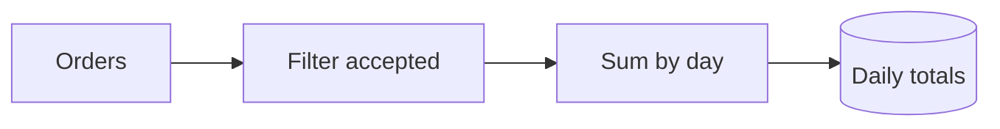

## Purpose and use

This fictional example demonstrates authoring. Analysts consume a daily total of accepted order amounts. It does not describe a real repository.

> One row represents one reference day. The reporting currency is fixed by the input contract.

## Processing flow

The job filters accepted orders before aggregation.



## Rules and example

Only accepted orders enter the total.

```chart
{"type":"bar","title":"Illustrative order amounts","unit":"currency units","source":"Fictional example in this document","data":[{"label":"Accepted","value":200},{"label":"Rejected","value":50}]}
```

<details>
<summary>Example query</summary>

```sql
SELECT reference_day, SUM(amount) AS total_amount
FROM orders
WHERE status = 'accepted'
GROUP BY reference_day;
```

</details>

Return to [purpose and use](#overview).
