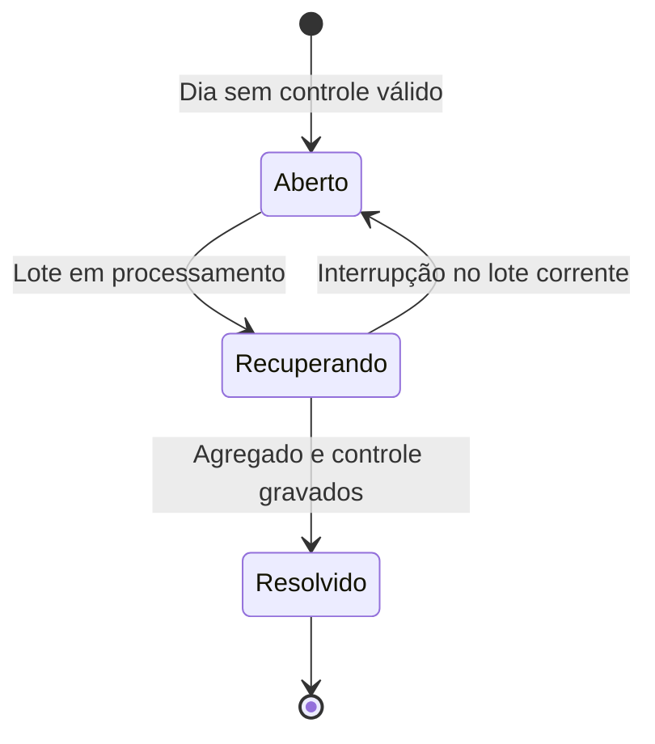
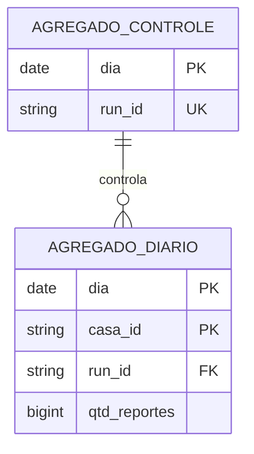

## Resumo executivo

Este exemplo ilustrativo demonstra o padrão visual v1.3.0 do gerador `project-html-docs`, preservando integralmente as **11 categorias de documentação** e apresentando os novos diagramas determinísticos para **Desenho da Solução**, **Fluxo em Estágios** e **Entidade de Tabelas**.

> Exemplo ilustrativo para validação visual da skill: métricas, nomes de tabelas e volumes abaixo reproduzem um cenário didático de comparação entre reportes do regulador e base sintética interna.

Consulte o [desenho da solução](#solucao), o [fluxo e processamento](#fluxo) e o [modelo de dados](#modelo) para inspecionar os novos componentes visuais.

## Visão funcional e escopo

O pipeline compara reportes mensais exportados pelo painel do regulador contra agregados diários calculados sobre a base integrada interna, destacando divergências por instituição, casa, método, endpoint e dia.

| Dimensão | Entrada | Saída entregue |
|---|---|---|
| Regulador | CSV mensal por API e dia (`entrada_comparador/`) | Tabela histórica `comparador_analitico_pcm_resultado` + view do BI |
| Base interna | Partições Delta `sand_obk.report_pcm_obk_dth_payinit` | Agregados `agregado_diario` e controle `agregado_controle` |

## Estado atual da solução

Os dois regimes de execução operam em conjunto: dias já consolidados são reaproveitados automaticamente, restringindo a leitura pesada apenas aos dias descobertos no intervalo do CSV.

```chart
{"type":"bar","title":"Exemplo ilustrativo de cobertura de dias na execução","unit":"dias","source":"Cenário ilustrativo v1.3.0","data":[{"label":"Dias reaproveitados (agregado válido)","value":17,"variant":"success"},{"label":"Dias calculados na base integrada","value":10,"variant":"warning"},{"label":"Dias com falha de leitura","value":0,"variant":"neutral"}]}
```

## Como usar

1. Deposite o arquivo CSV mensal do painel em `entrada_comparador/`.
2. Execute o job de comparação no workspace ou pelo runner local.
3. Confira o resultado na view do BI e valide os dias recalculados na tabela de controle.

## Desenho da solução

A arquitetura separa **entradas** (à esquerda) de dois estágios empilhados: o **Estágio 2 · Comparação** (rápido, executado em todo ciclo) e o **Estágio 1 · Sintética** (pesado, acionado apenas para dias sem agregado válido).

```solution
{
  "title": "Arquitetura em estágios 2D — Comparação e Sintética",
  "cols": 5,
  "colWidth": 212,
  "colGap": 54,
  "inputs": { "label": "ENTRADAS" },
  "zones": [
    {
      "id": "estagio2",
      "title": "ESTÁGIO 2 · COMPARAÇÃO",
      "subtitle": "rápido, roda em toda execução",
      "variant": "warm",
      "row": 0,
      "colStart": 1,
      "colSpan": 4
    },
    {
      "id": "estagio1",
      "title": "ESTÁGIO 1 · SINTÉTICA",
      "subtitle": "pesado, só dias que não podem ser reaproveitados",
      "variant": "cool",
      "row": 1,
      "colStart": 1,
      "colSpan": 4,
      "callouts": [
        {
          "col": 4,
          "row": 1,
          "role": "analytical",
          "text": "grava ao fim de cada lote: uma interrupção perde só o lote corrente.\n\nroda como job no workspace ou local pelo runner"
        }
      ]
    }
  ],
  "nodes": [
    {
      "id": "csv_painel",
      "col": 0,
      "row": 0,
      "role": "regulator",
      "title": "CSV do painel",
      "lines": [
        "Detalhamento Reporte: por API e dia",
        "pasta `entrada_comparador/`",
        "1 arquivo, 1 mês"
      ]
    },
    {
      "id": "step1",
      "col": 1,
      "row": 0,
      "step": 1,
      "role": "step",
      "title": "Ler e validar o CSV",
      "lines": [
        "valida chaves e frações; id = hash do conteúdo; corte = fim do último dia; último dia não comparado"
      ]
    },
    {
      "id": "step4",
      "col": 3,
      "row": 0,
      "step": 4,
      "role": "step",
      "title": "Comparar",
      "lines": [
        "full outer join por instituição · casa · método · endpoint · dia; diferenças e situação de cada grupo"
      ]
    },
    {
      "id": "resultado",
      "col": 4,
      "row": 0,
      "shape": "cylinder",
      "role": "regulator",
      "title": "resultado",
      "lines": [
        "`comparador_analitico_pcm_resultado`",
        "histórico + view do BI"
      ]
    },
    {
      "id": "step5",
      "col": 4,
      "row": 0,
      "step": 5,
      "role": "step",
      "title": "Arquivar CSV",
      "lines": [
        "→ `processado_comparador/`"
      ]
    },
    {
      "id": "base_unify",
      "col": 0,
      "row": 1,
      "shape": "cylinder",
      "role": "analytical",
      "title": "Base integrada (unify)",
      "lines": [
        "`sand_obk.report_pcm_obk_dth_payinit`",
        "~200 mi reportes/dia",
        "partição `dat_ref_carga`"
      ]
    },
    {
      "id": "step2",
      "col": 1,
      "row": 1,
      "step": 2,
      "role": "step",
      "title": "Planejar",
      "lines": [
        "lê o histórico Delta da unify e a tabela de controle; separa dias reaproveitáveis × a calcular (em lotes de dias consecutivos)"
      ]
    },
    {
      "id": "step3",
      "col": 2,
      "row": 1,
      "step": 3,
      "role": "step",
      "title": "Calcular cada lote",
      "lines": [
        "lê só as partições D...D+7; aplica o escopo da regra; deduplica por obrigação (xfapi + org + papel); agrega por dia × casa × método × endpoint"
      ]
    },
    {
      "id": "agg_diario",
      "col": 3,
      "row": 1,
      "role": "analytical",
      "title": "agregado_diario",
      "lines": [
        "a sintética · ~250 linhas/dia",
        "sem xfapi"
      ],
      "meta": "Grão: dia × casa × método × endpoint"
    },
    {
      "id": "agg_ctrl",
      "col": 3,
      "row": 1,
      "role": "analytical",
      "title": "agregado_controle",
      "lines": [
        "1 linha por dia · reuso"
      ]
    }
  ],
  "edges": [
    { "from": "csv_painel", "to": "step1", "fromSide": "right", "toSide": "left" },
    { "from": "step1", "to": "step4", "fromSide": "right", "toSide": "left", "label": "linhas do regulador (escopo)" },
    { "from": "step4", "to": "resultado", "fromSide": "right", "toSide": "left", "role": "regulator" },
    { "from": "resultado", "to": "step5", "fromSide": "bottom", "toSide": "top" },
    { "from": "step1", "to": "step2", "fromSide": "bottom", "toSide": "top", "label": "dias e corte" },
    { "from": "base_unify", "to": "step2", "fromSide": "right", "toSide": "left", "style": "dashed", "role": "analytical", "label": "histórico" },
    { "from": "step2", "to": "step3", "fromSide": "right", "toSide": "left" },
    { "from": "step3", "to": "agg_diario", "fromSide": "right", "toSide": "left", "role": "analytical" },
    { "from": "agg_diario", "to": "step4", "fromSide": "top", "toSide": "bottom", "label": "dias válidos\n(dia, run_id)" },
    { "from": "base_unify", "to": "step3", "fromSide": "bottom", "toSide": "bottom", "channel": "bottom", "role": "analytical", "label": "partições D...D+7 do lote, numa versão Delta fixa (só colunas necessárias)" },
    { "from": "agg_ctrl", "to": "step2", "fromSide": "bottom", "toSide": "bottom", "channel": "bottom-inner", "style": "dashed", "label": "controle lido no planejamento" }
  ],
  "legend": [
    { "type": "box", "role": "regulator", "label": "dados do regulador e resultado" },
    { "type": "box", "role": "analytical", "label": "base integrada e sintética" },
    { "type": "box", "role": "step", "label": "etapas do notebook" },
    { "type": "dashed", "role": "neutral", "label": "leitura de metadados / controle" }
  ],
  "note": "O estágio 1 só lê a unify para os dias sem agregado válido. Em 03/11: 17 dias reaproveitados e 10 calculados (18 min 35 s). Nova extração da mesma semana reaproveita tudo (~21 s). Passos do notebook: ① = Passo 2, ② e ③ = Passo 3, ④ = Passos 4–5, gravação e ⑤ = Passos 6–7."
}
```

| Objeto | Papel | Lido / gravado |
|---|---|---|
| `entrada_comparador/*.csv` | Entrada mensal do painel regulatório | Lido no passo ① e movido para `processado_comparador/` no passo ⑤ |
| `sand_obk.report_pcm_obk_dth_payinit` | Base integrada particionada por `dat_ref_carga` | Lida seletivamente por lote `D...D+7` no passo ③ |
| `agregado_diario` | Sintética diária (~250 linhas/dia) | Gravada por lote no passo ③ e lida no passo ④ |
| `agregado_controle` | Metadados de elegibilidade e reuso (1 linha/dia) | Lida no planejamento ② e atualizada ao fim de cada lote ③ |
| `comparador_analitico_pcm_resultado` | Histórico final de divergências + view BI | Gravada no passo ④ |

## Fluxo e processamento

Os fluxogramas utilizam cartões de decisão compactos (sem losangos desproporcionais) e ramos semânticos para separar o caminho nominal do tratamento de exceção ou reuso.

```flow
{
  "title": "Fluxo de decisão de lote e reaproveitamento diário",
  "cols": 4,
  "colWidth": 228,
  "colGap": 42,
  "zones": [
    { "id": "f1", "title": "1 · VERIFICAÇÃO DE REUSO", "subtitle": "planejamento por dia", "variant": "neutral", "row": 0, "colStart": 0, "colSpan": 2 },
    { "id": "f2", "title": "2 · EXECUÇÃO & PUBLICAÇÃO", "subtitle": "processamento seletivo e gravação", "variant": "teal", "row": 0, "colStart": 2, "colSpan": 2 }
  ],
  "nodes": [
    { "id": "in", "col": 0, "row": 0, "step": 1, "role": "step", "title": "Avaliar dia do corte", "lines": ["compara hash do CSV e `agregado_controle`"] },
    { "id": "dec", "col": 1, "row": 0, "shape": "decision", "role": "warning", "title": "Dia já tem agregado válido?", "lines": ["mesma versão Delta e escopo íntegro"] },
    { "id": "reuso", "col": 2, "row": 0, "step": 2, "role": "success", "title": "Reaproveitar agregado", "lines": ["pula leitura da unify", "lê `agregado_diario` (~21 s)"] },
    { "id": "calc", "col": 2, "row": 1, "step": 3, "role": "analytical", "title": "Calcular lote D...D+7", "lines": ["deduplica `xfapi + org + papel`", "grava lote + controle"] },
    { "id": "pub", "col": 3, "row": 0, "step": 4, "role": "output", "title": "Consolidar resultado", "lines": ["full outer join e gravação em `comparador_analitico_pcm_resultado`"] }
  ],
  "edges": [
    { "from": "in", "to": "dec" },
    { "from": "dec", "to": "reuso", "branch": "yes", "label": "Sim" },
    { "from": "dec", "to": "calc", "fromSide": "bottom", "toSide": "left", "branch": "no", "label": "Não · calcular" },
    { "from": "reuso", "to": "pub" },
    { "from": "calc", "to": "pub", "fromSide": "right", "toSide": "bottom", "label": "dias válidos" }
  ],
  "legend": [
    { "type": "box", "role": "warning", "label": "Decisão de elegibilidade" },
    { "type": "box", "role": "success", "label": "Caminho de reuso rápido" },
    { "type": "box", "role": "analytical", "label": "Caminho pesado (leitura Delta)" }
  ]
}
```

### Ciclo de estados do lote (Mermaid aprimorado)



## Regras funcionais e cálculos

1. **Corte temporal do CSV**: o último dia presente no arquivo mensal não entra na comparação para evitar confronto com dia ainda aberto na origem.
2. **Deduplicação na sintética**: obrigações repetidas na mesma partição são deduplicadas por `(xfapi, org, papel)` antes da agregação por `dia × casa × método × endpoint`.

> Regra de negócio: dois arquivos mensais com o mesmo conteúdo (mesmo hash SHA-256) e mesma versão Delta na origem nunca disparam releitura pesada na `unify` — apenas consolidam os dias válidos em ~21 s.

> Exemplo prático: se um arquivo mensal cobre `01/11` a `28/11`, o corte exclui `28/11`. Dos `27` dias elegíveis, se `17` já constam em `agregado_controle` com status válido, o Estágio 1 lê a base integrada apenas para os `10` dias pendentes em lotes de `D...D+7`.

## Modelo e relacionamento dos dados

O modelo distingue explicitamente **tabelas físicas**, **visões/agregações derivadas** (conectadas por linhagem tracejada, nunca por FK fictícia) e **contratos/metadados**, sempre exibindo o **grão** e as colunas na ordem natural `[PK/FK] nome — tipo`.

```schema
{
  "title": "Entidades de tabela, controle e linhagem analítica",
  "colGap": 134,
  "rowGap": 62,
  "entities": [
    {
      "id": "unify",
      "name": "report_pcm_obk_dth_payinit",
      "kind": "table",
      "grain": "Grão: 1 linha = evento bruto reportado (partição dat_ref_carga)",
      "col": 0,
      "row": 0,
      "columns": [
        { "key": "PK", "name": "dat_ref_carga", "type": "date" },
        { "key": "PK", "name": "xfapi_interaction_id", "type": "string" },
        { "key": "FK", "name": "org_id", "type": "string" },
        { "name": "papel", "type": "string" },
        { "name": "endpoint", "type": "string" },
        { "name": "metodo", "type": "string" }
      ]
    },
    {
      "id": "agg_diario",
      "name": "agregado_diario",
      "kind": "mart",
      "grain": "Grão: 1 linha = dia × casa × método × endpoint (sem xfapi)",
      "col": 1,
      "row": 0,
      "columns": [
        { "key": "PK", "name": "dia", "type": "date" },
        { "key": "PK", "name": "casa_id", "type": "string" },
        { "key": "PK", "name": "metodo", "type": "string" },
        { "key": "PK", "name": "endpoint", "type": "string" },
        { "key": "FK", "name": "run_id", "type": "string" },
        { "name": "qtd_reportes", "type": "bigint" }
      ]
    },
    {
      "id": "agg_ctrl",
      "name": "agregado_controle",
      "kind": "table",
      "grain": "Grão: 1 linha = dia processado (controle de reuso)",
      "col": 1,
      "row": 1,
      "columns": [
        { "key": "PK", "name": "dia", "type": "date" },
        { "key": "UK", "name": "run_id", "type": "string" },
        { "name": "delta_version", "type": "bigint" },
        { "name": "status_lote", "type": "string" }
      ]
    },
    {
      "id": "resultado",
      "name": "comparador_analitico_pcm_resultado",
      "kind": "mart",
      "grain": "Grão: 1 linha = execução × instituição × casa × método × endpoint × dia",
      "col": 2,
      "row": 0,
      "columns": [
        { "key": "PK", "name": "execucao_id", "type": "string" },
        { "key": "PK", "name": "dia", "type": "date" },
        { "key": "PK", "name": "endpoint", "type": "string" },
        { "name": "qtd_regulador", "type": "bigint", "nullable": true },
        { "name": "qtd_sintetica", "type": "bigint", "nullable": true },
        { "name": "situacao", "type": "string" }
      ]
    },
    {
      "id": "csv_meta",
      "name": "manifesto_csv_entrada",
      "kind": "json",
      "grain": "Grão: 1 objeto = arquivo mensal validado",
      "col": 0,
      "row": 1,
      "columns": [
        { "key": "PK", "name": "file_sha256", "type": "string" },
        { "name": "corte_final", "type": "date" },
        { "name": "arquivo_origem", "type": "string" }
      ]
    }
  ],
  "relations": [
    { "from": "unify", "to": "agg_diario", "kind": "lineage", "label": "dedup xfapi + GROUP BY" },
    { "from": "agg_ctrl", "to": "agg_diario", "fromSide": "top", "toSide": "bottom", "fromCard": "1", "toCard": "1..N", "label": "valida reuso por run_id" },
    { "from": "agg_diario", "to": "resultado", "kind": "lineage", "label": "full outer join" },
    { "from": "csv_meta", "to": "resultado", "channel": "bottom", "kind": "lineage", "label": "escopo e corte do regulador" }
  ],
  "note": "Linhas tracejadas representam derivação analítica ou junção lógica; pés de galinha representam cardinalidade real entre controle e partições diárias."
}
```

### Dicionário consolidado das principais colunas

| Tabela | Coluna | Papel | Tipo | Descrição funcional |
|---|---|---|---|---|
| `unify` | `dat_ref_carga` | `PK` `PARTIÇÃO` | `date` | Data de referência da partição lida em lotes `D...D+7` |
| `unify` | `xfapi_interaction_id` | `PK` `NOT NULL` | `string` | Identificador da interação usado na deduplicação |
| `agregado_controle` | `dia` | `PK` `NOT NULL` | `date` | Dia calendário validado e elegível para reaproveitamento |
| `agregado_controle` | `run_id` | `UK` `NOT NULL` | `string` | Identificador da execução que produziu o agregado do dia |
| `agregado_diario` | `casa_id` | `PK` `NOT NULL` | `string` | Instituição / casa participante agrupada na sintética |
| `agregado_diario` | `run_id` | `FK` `NOT NULL` | `string` | Referência lógica ao lote gravado em `agregado_controle` |
| `agregado_diario` | `qtd_reportes` | Métrica | `bigint` | Contagem deduplicada de obrigações no grupo diário |
| `resultado` | `qtd_regulador` | Métrica | `bigint?` | Volume informado no CSV do regulador (nulo se ausente na origem) |
| `resultado` | `qtd_sintetica` | Métrica | `bigint?` | Volume apurado na base integrada (nulo se ausente na unify) |
| `resultado` | `situacao` | Classificação | `string` | Situação da conciliação (`CONFORME`, `DIVERGENTE`, `SOMENTE_ORIGEM`) |

### Compatibilidade com `erDiagram` Mermaid aprimorado



## Operação e recuperação

Em caso de interrupção durante o Estágio 1, apenas o lote corrente (`D...D+7`) deixa de ser gravado em `agregado_controle`; uma nova execução retoma automaticamente dos dias pendentes sem reprocessar lotes já confirmados.

> Atenção: o arquivo CSV original só é movido para `processado_comparador/` no passo ⑤ após a gravação integral do resultado.

| Sintoma | Causa provável | Parâmetro / Ação de recuperação |
|---|---|---|
| Execução interrompida no meio do mês | Falha transitória de cluster durante um lote `D...D+7` | Reexecutar normalmente; lotes gravados anteriormente permanecem reutilizáveis |
| Diferença concentrada apenas no último dia | Arquivo extraído com dia ainda aberto na origem | Conferir regra de corte (`fim do último dia`) antes de acionar reprocessamento |

## Decisões e limites

- A divisão em dois estágios evita leituras repetidas de `~200 mi reportes/dia` quando o mesmo arquivo mensal é revalidado.
- Agregações diárias omitem `xfapi` para manter cardinalidade enxuta (`~250 linhas/dia`).

> Limitação: a tabela `agregado_diario` não preserva granularidade por `xfapi_interaction_id`; investigações individuais de evento exigem consulta direta na `unify` filtrando `dat_ref_carga`.

## Glossário e referências

| Termo | Definição |
|---|---|
| Grão | O que exatamente uma única linha ou objeto representa |
| Sintética | Projeção diária pré-agregada para aceleração da comparação |
| Linhagem | Derivação entre camadas analíticas, distinta de chave estrangeira física |
| Reaproveitamento | Leitura do agregado pré-computado quando o dia já possui `run_id` e versão Delta válidos |

