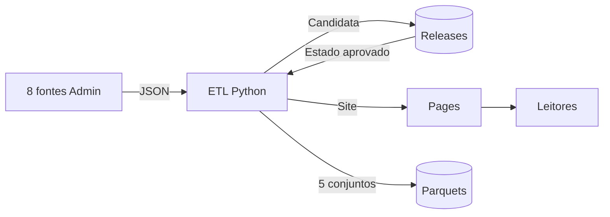
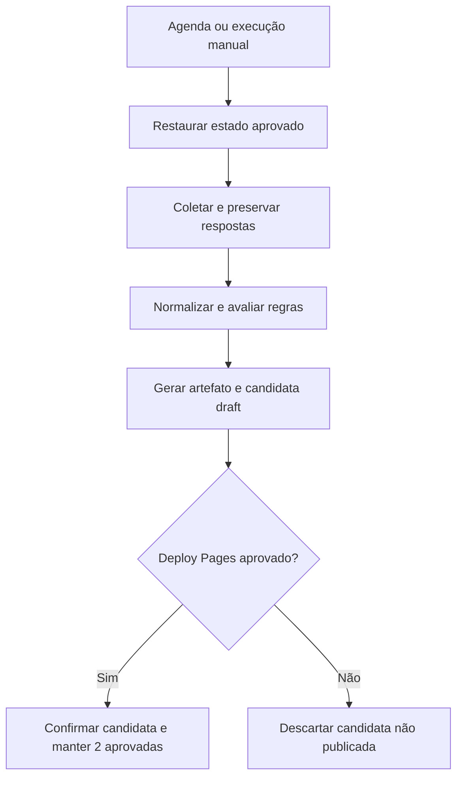
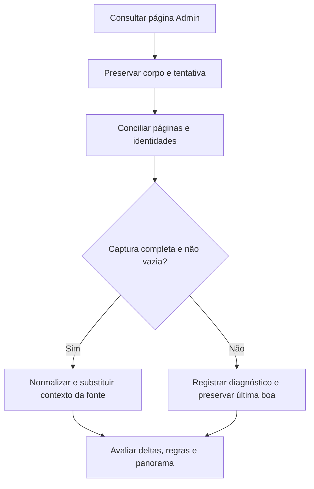
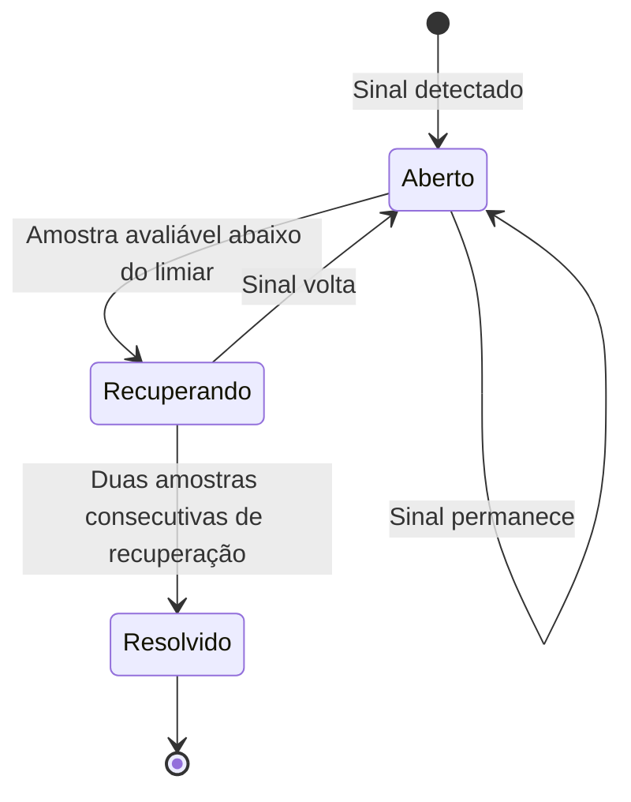
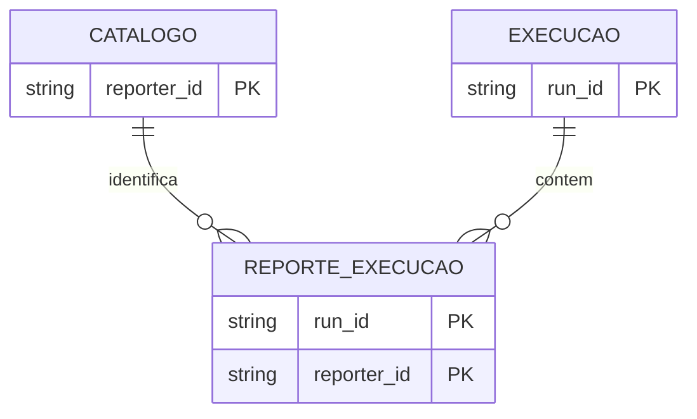
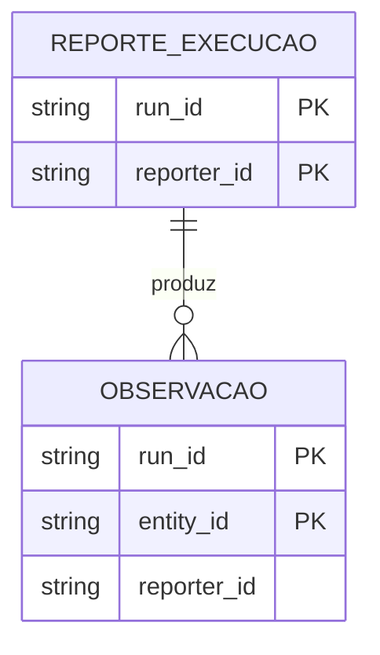
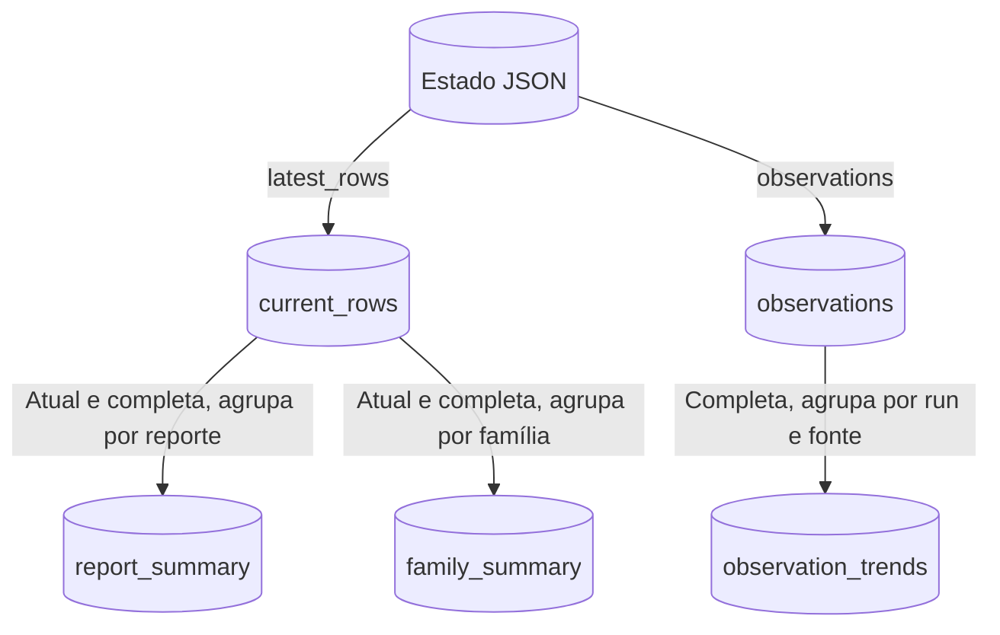

## Resumo executivo

O Admin Metrics reúne os reportes operacionais de oito fontes Santander em um panorama para acompanhar erros, rejeições, médias de resposta e condições de coleta. Ajuda PO, gestão, analistas e engenharia a identificar onde aprofundar uma investigação, com o volume e o momento de cada observação.

<div class="cards">
<div class="card"><h3>Qual pergunta responde?</h3><p>Quais fontes e serviços reportados concentram sinais de atenção, e os dados disponíveis permitem interpretar esses sinais?</p></div>
<div class="card"><h3>O que entrega?</h3><p>Dashboard estático, incidentes explicáveis, histórico de observações, exportação CSV, cinco conjuntos Parquet e documentação.</p></div>
<div class="card"><h3>Como apoiar uma decisão?</h3><p>Conferir a idade dos dados, comparar taxa e volume, abrir o detalhe e separar um problema reportado de uma falha de coleta.</p></div>
</div>

O banco declara as métricas dos serviços no endpoint Admin. O monitor mede independentemente a duração e o resultado de sua própria consulta a esse endpoint. Essas duas observações têm significados diferentes: uma média declarada do serviço não é a duração da coleta.

> Quando a fonte falha, o sistema pode preservar um panorama anterior. A data dos últimos dados válidos e a saúde da tentativa atual permitem entender essa continuidade sem confundir valores antigos com uma observação nova.

Para consumir o resultado, comece por [Como usar o dashboard](#uso). Para entender os cálculos, consulte [Regras funcionais](#regras). A [arquitetura](#solucao), o [fluxo](#fluxo) e o [modelo de dados](#modelo) descrevem a implementação.

## Visão funcional e escopo

O processo transforma reportes públicos agregados em informação operacional comparável. A unidade monitorada é a combinação de uma fonte do catálogo com um endpoint descrito no seu reporte.

| Etapa funcional | O que acontece | Resultado para o leitor |
|---|---|---|
| Observar | Consulta os oito Admins configurados | Horário, resposta HTTP e métricas recebidas |
| Organizar | Normaliza campos, identidades e referências de tempo | Linhas comparáveis e valores inválidos sinalizados |
| Interpretar | Calcula taxas, deltas elegíveis e sinais | Incidentes e contexto de volume |
| Apresentar | Publica panorama, detalhes e histórico | Leitura do conjunto e investigação por fonte/endpoint |
| Preservar | Mantém estado e pacotes aprovados | Continuidade entre runners e recuperação operacional |

### Fontes acompanhadas

| Reporte | Host Admin |
|---|---|
| Santander | `openbanking.api.santander.com.br` |
| Santander CCVM | `ccvm.api.santander.com.br` |
| Aymoré | `financiamentos.api.santander.com.br` |
| Getnet | `getnet.api.santander.com.br` |
| Hyundai Capital | `hyundai.api.santander.com.br` |
| RCI · Nissan | `nissan.api.santander.com.br` |
| RCI · Renault | `renault.api.santander.com.br` |
| Toro | `toro.api.santander.com.br` |

Em todos os hosts, a coleta usa `GET /open-banking/admin/v2/metrics`. A associação das fontes é operacional pelo catálogo/Diretório; não constitui uma conclusão sobre controle societário. Nissan e Renault permanecem reportes distintos mesmo compartilhando CNPJ.

### O que entra e o que sai

Entram métricas declaradas de chamadas, erros, rejeições, médias de resposta, TPS e disponibilidade, incluindo valores atuais e posições de dias anteriores. Saem dados normalizados, agregados, ocorrências de incidentes e os artefatos para consulta.

O monitor não chama os serviços de clientes descritos no reporte e não executa pagamentos. O navegador lê arquivos publicados; não consulta as APIs bancárias. Para o negócio, os sinais orientam investigação. Os limiares configurados não representam um atestado regulatório ou uma medição contínua de disponibilidade.

## Estado atual da solução

Esta v2 descreve o checkout `a24588f` da aplicação 1.2.0, consultado em 14/11/2026. O modelo de captura é 3 e o envelope persistido é 1. São identificadores com funções distintas; não representam três versões concorrentes da aplicação.

| Capacidade implementada | Comportamento |
|---|---|
| Coleta agendada e manual | GitHub Actions; cron `17 * * * *` UTC |
| Oito fontes independentes | Uma falha observável de fonte não elimina o diagnóstico das outras |
| Panorama coerente | Um ciclo completo e um dia de referência por recorte |
| Continuidade | Último panorama válido preservado e rotulado quando necessário |
| Histórico | 30 dias de estado normalizado; séries públicas de 72 horas |
| Incidentes | Abertura, confirmação por persistência, recuperação e resolução |
| Consumo técnico | DuckDB e cinco arquivos Parquet reconstruídos no build |
| Publicação | Dashboard e manual estáticos; estado remoto em Releases aprovadas |

Esta documentação registra capacidades e configurações. Nenhuma nova coleta foi executada para sua geração, e não se apresenta um status de saúde em tempo real. A situação operacional deve ser lida no dashboard, com seus horários e identificação da execução.

### Duas janelas com propósitos diferentes

```chart
{"type":"bar","title":"Janelas configuradas de histórico","unit":"dias","source":"config/rules.json · retention_days e dashboard_history_days","data":[{"label":"Estado normalizado","value":30},{"label":"Séries públicas","value":3}]}
```

A janela de três dias se aplica às séries e ao monitor no payload público. Panoramas preservados, contexto anterior e incidentes ativos podem carregar informação mais antiga, enquanto estiver retida. Bronze e pacotes remotos usam quantidades de ciclos/pacotes, descritas em [Retenção](#operacao).

## Como usar o dashboard

Abra o [dashboard do Admin Metrics](https://alebitencourtx.github.io/admin-metrics/). Comece pela atualidade e pela cobertura dos dados antes de comparar indicadores.

<div class="cards">
<div class="card"><h3>1 · Confira o contexto</h3><p>Leia a última tentativa, os últimos dados válidos e a cobertura. Uma tentativa recente vazia não renova a idade dos dados.</p></div>
<div class="card"><h3>2 · Compare taxa e volume</h3><p>A mesma taxa pode representar poucos eventos ou muitos erros. O ranking prioriza quantidade de erros.</p></div>
<div class="card"><h3>3 · Abra o detalhe</h3><p>Confronte histórico, deltas e flags. Um incidente em recuperação ainda não está resolvido.</p></div>
</div>

### Roteiro de consulta

1. **Panorama:** confira o recorte e a data. O aviso **DADOS ANTERIORES** indica preservação de um ciclo válido anterior.
2. **Fonte:** selecione um reporte ou clique no ranking. O filtro muda o recorte global; “Todos” recompõe a visão de conjunto.
3. **Incidentes:** compare severidade, estado, evidência e confirmação. Use a opção de incluir resolvidos quando necessário.
4. **Tendências:** escolha taxa de erro, média ou chamadas do dia. Observe horário/valor dos pontos e as lacunas; não some os acumulados de vários horários.
5. **Endpoints:** use busca, família e ordenação. Clique no endpoint para consultar médias anteriores, deltas, flags e origem.
6. **Coleta e monitor:** confira HTTP, quantidade de registros e tentativas. O monitor apresenta uma matriz execução × API, em páginas de 12 execuções.
7. **Exportação:** “Exportar endpoints” gera o CSV de todas as linhas do filtro, com campos de contexto e evidência.

| O leitor vê | Como interpretar |
|---|---|
| Tentativa nova + panorama antigo | A publicação incorporou um diagnóstico atual; as métricas válidas continuam anteriores |
| `fresh=false` em uma exportação | A linha é de uma execução anterior, não uma medição nova |
| Ausência de ponto | O horário pode não ter sido observado ou não ser comparável |
| HTTP 403 no Admin | A consulta foi recusada; não determina a causa nem a disponibilidade de todos os serviços |
| Média alta | A média declarada é elevada; não informa percentis como p95 |

O detalhe mantém separados os dias anteriores declarados pelo banco e as observações próprias do monitor. A interface mostra D−1 a D−3; a avaliação de recorrência pode usar até sete posições do contrato.

O CSV usa UTF-8 com BOM e separador ponto-e-vírgula. Busca, família e ordenação afetam tabela e exportação. Valores preservados continuam identificados, e campos com prefixos de fórmula recebem proteção no CSV.

## Desenho da solução

A solução é um ETL em lote executado em um único runner temporário do GitHub Actions. O estado persistido permite continuar o histórico entre execuções; DuckDB é embutido no processo, sem serviço de banco permanente.



O ETL Python reúne coleta, normalização e construção no runner temporário do GitHub Actions. O desenho mostra componentes e intercâmbios. A confirmação de uma candidata em Release depende do deploy aprovado, detalhado no [fluxo](#fluxo). Os Parquets são produzidos no diretório de dados do build; não há promessa de disponibilizá-los no Pages.

| Componente | Responsabilidade | Implementação |
|---|---|---|
| Catálogo e regras | Define fontes, limiares e janelas | `config/reporters.json`, `config/rules.json` |
| Coletor | HTTP, concorrência, paginação e retry | `collect.py` |
| Normalização e análise | Identidades, métricas, deltas e incidentes | `analysis.py` |
| Saúde e panorama | Distingue tentativa atual de último conjunto válido | `health.py`, `panorama.py` |
| Persistência | Bronze, estado, escrita e exclusão mútua | `storage.py`, `archive.py` |
| Construção | Arrow, SQL, Parquet, payload e HTML | `build.py`, `marts.sql` |
| Publicação remota | Restore, candidata, confirmação e retenção | `cloud_pipeline.py`, `pages.yml` |

O dashboard precisa dos arquivos da publicação. Este manual v2 é um HTML independente, com estilos, scripts, tabelas e diagramas incorporados.

## Fluxo dos dados e publicação

Uma nova coleta restaura o estado aprovado, observa as fontes e produz um candidato. A publicação do site e a confirmação desse estado são etapas distintas.



Falhas estruturais de configuração, integridade ou construção interrompem o avanço. Falhas observáveis da origem são registradas como dados de diagnóstico e podem resultar em publicação bem-sucedida. Se o deploy terminar e a confirmação falhar, o site pode referenciar uma candidata ainda draft; a reconciliação está em [Recuperação](#operacao).

### Dentro da coleta



São permitidas quatro fontes simultâneas e uma página por vez por fonte. Cada operação HTTP tem timeout de 20 segundos; o limite é de 20 páginas, 16 MiB por resposta e 10.000 identidades por fonte. O timeout HTTP não é um prazo absoluto para o ciclo inteiro.

O retry HTTP tem até três tentativas e se limita a transporte ou status 408/429/500/502/503/504/529, com `Retry-After` limitado a 15 segundos. Quando uma fonte anteriormente preenchida retorna vazio, existem até duas recapturas adicionais, após 10 e 30 segundos por padrão; o bootstrap não repete vazio por essa regra. Recaptura e retry HTTP são mecanismos distintos.

Identidades repetidas não aumentam o volume. Duplicatas divergentes tornam a fonte incompleta; a primeira identidade é preservada como evidência. Ao cobrir `totalRecords`, a coleta pode terminar mesmo quando `totalPages` anuncia páginas excedentes, registrando a inconsistência. O esquema de entrada usa `period=ALL&page-size=1000&page=N`.

Push na `main` e execução manual sem atualização de dados republicam o estado aprovado. No bootstrap sem estado, o processo pode realizar a coleta inicial. O grupo de concorrência remoto impede sobreposição entre estado e publicação.

## Regras funcionais e cálculos

As regras transformam métricas declaradas em sinais de triagem. A interpretação depende do volume, da validade dos campos e da comparabilidade temporal.

| Medida | Cálculo e elegibilidade | Exemplo |
|---|---|---|
| Taxa de erro | `100 × errors / calls`, com chamadas positivas e erro válido ≤ chamadas | 100 erros / 1.000 chamadas = 10% |
| Taxa de rejeição | Mesma lógica, usando rejeições e seu próprio denominador elegível | Rejeição ausente não vira zero |
| Taxa agregada | Soma dos numeradores elegíveis / soma dos denominadores correspondentes | Não fazer média simples das taxas por endpoint |
| Média ponderada | `Σ(mean_ms × calls) / Σ(calls)`; ambas positivas | Preserva peso do volume, sem produzir p95 |
| Delta | Diferença entre contadores comparáveis de duas observações | 1.100 − 1.000 = 100 chamadas no intervalo aceito |

### Limiares configurados

| Sinal | Atenção | Crítico / observação |
|---|---|---|
| Erro | ≥5%, com ≥100 chamadas | ≥20%, com ≥1.000 chamadas |
| Rejeição | ≥5%, com ≥100 chamadas | Não há limiar crítico próprio de rejeição |
| Média de resposta | ≥2.000 ms, com ≥100 chamadas | ≥4.000 ms, com ≥100 chamadas |
| Regressão de média | ≥2× a mediana de pelo menos 3 médias diárias anteriores positivas | Pode ocorrer abaixo de 2.000 ms |
| Recorrência contextual | Pelo menos 3 dias anteriores com erro ≥5% e ≥100 chamadas/dia | Contexto declarado, não novas coletas retroativas |
| Falha da coleta Admin | Primeira falha observada | Segunda falha consecutiva |

```chart
{"type":"bar","title":"Limiares da média de resposta declarada","unit":"milissegundos","source":"config/rules.json · requer ao menos 100 chamadas","data":[{"label":"Atenção","value":2000},{"label":"Crítico","value":4000}]}
```

### Exemplos de interpretação

| Situação | Resultado |
|---|---|
| 100 chamadas e 30 erros | 30%; atenção, pois não atinge as 1.000 chamadas exigidas para crítico |
| 1.000 chamadas e 250 erros | 25%; crítico, inicialmente provisório |
| 10 chamadas e 5 erros | A taxa é 50%, mas o mínimo de 100 chamadas impede o sinal de incidente |
| Antes 1.000/100; depois 1.100/101 | Delta elegível: 100 chamadas e 1 erro, taxa de 1% |
| Métricas iguais, só `requestTime` mudou | Não inferir tráfego novo no intervalo |
| Origem falha depois de sinal elevado | A ausência de dados não comprova recuperação |

### Tempo, validade e panorama

O instante UTC de aquisição identifica nossa observação. O dia analítico vem do cabeçalho HTTP `Date`, convertido para `America/Sao_Paulo`, ou da aquisição quando o cabeçalho não pode ser interpretado. Isso não comprova o fuso de consolidação do banco. Capturas cujas páginas cruzam o dia ficam incompletas.

Os deltas exigem mesma entidade, mesmo dia, tempo crescente, fontes completas e contadores válidos e não decrescentes. Reset/revisão e deltas incoerentes suspendem a comparação pertinente. Não existe média de latência intervalar inferida.

Os marts atuais filtram `fresh AND source_complete`. O panorama usa um único ciclo completo e dia comum por recorte. Assim, pode preservar um ciclo anterior enquanto a saúde continua descrevendo a tentativa atual. Não soma silenciosamente fontes de dias ou ciclos diferentes.

<details>
<summary>Campos inválidos e ausências</summary>

Inteiros fora do contrato, negativos, booleanos ou incompatíveis tornam-se nulos e são sinalizados. Erros/rejeições acima das chamadas não participam das taxas correspondentes. Uptime é uma razão entre 0 e 1; a interface exibe percentual. Flags registram também inconsistências de horário, arrays anteriores, TPS e disponibilidade. O JSON de saída não admite NaN/Infinity.

</details>

## Situações, incidentes e continuidade

Há três dimensões de leitura: saúde da coleta, atualidade das métricas e situação de cada incidente. Um workflow concluído não significa que todas as fontes retornaram dados válidos.

| Dimensão | Estados / leitura |
|---|---|
| Saúde da coleta | `healthy`, `partial`, `unavailable` |
| Resultado por fonte | Válido, vazio, falha HTTP, transporte ou reporte inválido |
| Métricas do panorama | Ciclo atual ou último ciclo completo preservado |
| Incidente | Aberto, em recuperação, resolvido; confirmação é uma dimensão adicional |



A segunda detecção consecutiva confirma persistência. Isso pode ocorrer sobre um acumulado que não mudou; não comprova erros novos entre os ciclos. Após resolução, uma nova detecção abre outra ocorrência, com identidade própria.

Amostras desconhecidas, inválidas ou insuficientes não resolvem a regra afetada e interrompem a sequência de recuperação. A falta de um endpoint em um reporte completo também não o declara saudável. Reset de contadores suspende regras dependentes desses contadores; latência pode continuar avaliável quando seus próprios campos e volume são válidos.

### Por que manter valores anteriores?

Sem continuidade, uma falha de consulta poderia apagar o contexto necessário à análise. O sistema conserva a última captura boa por fonte e um panorama coerente por recorte, identificando o que é anterior. Valores preservados não são inseridos como novos pontos no histórico. Sem um panorama elegível na retenção, as métricas ficam indisponíveis.

<details>
<summary>Estados da comparação entre observações</summary>

| `interval_state` | Significado |
|---|---|
| `first_observation` | Sem observação anterior retida |
| `observation_time_not_increasing` | Instantes sem progressão temporal |
| `day_changed` | Mudou o dia analítico |
| `incomplete_source` | Uma fonte da comparação está incompleta |
| `unchanged_report` | O fingerprint analítico não mudou |
| `invalid_counter` | Contador inválido ou numerador acima de chamadas |
| `counter_reset_or_revision` | Um contador diminuiu |
| `inconsistent_delta` | Diferenças incompatíveis, como erro delta acima de chamadas delta |
| `valid` | Diferenças aceitas; uma taxa ainda exige denominador positivo |

Os estados específicos de erro e rejeição preservam a elegibilidade de cada numerador. Uma falha num campo não deve ser interpretada como invalidade automática de todas as métricas.

</details>

## Modelo e relacionamento dos dados

O projeto mantém um estado JSON e produz uma projeção tabular para análise. O diagrama abaixo mostra identidades e relações lógicas entre estruturas; os rótulos PK indicam identidade no modelo, sem afirmar a existência de restrições SQL no JSON.





Uma execução pode ter reportes sem observações quando a coleta não produz linhas. `entity_id` deriva de `reporter_id + endpoint`, via SHA-256 truncado a 24 caracteres. `REPORTE_EXECUCAO` no desenho corresponde conceitualmente a `runs[].reports[]`, não a uma tabela física separada.

### Objetos persistidos e derivados

| Objeto | Uma linha / objeto representa | Escrita e uso |
|---|---|---|
| `state.json → runs[]` | Uma execução, com reportes e tentativas | Estado persistido, inclusive falhas; retenção por execução |
| `state.json → observations[]` | Execução × entidade reportada | Histórico normalizado de até 30 dias |
| `state.json → latest_rows[]` | Último contexto por entidade de cada fonte | Captura completa nova substitui o conjunto da fonte |
| `state.json → incidents[]` | Ocorrência de uma regra para uma entidade | Abertura, detecção, recuperação e resolução |
| `bronze/<sha>.json` | Corpo exato de uma resposta HTTP | Endereçado pelo hash; retenção em ciclos |
| `current_rows` | Projeção tipada do último contexto por entidade | Tabela DuckDB e Parquet reconstruídos no build |
| `observations` | Projeção tipada de execução × entidade | Tabela DuckDB e Parquet reconstruídos no build |
| `report_summary` | Reporte com linhas atuais completas | Agregação SQL e Parquet |
| `family_summary` | Família com linhas atuais completas | Agregação SQL e Parquet |
| `observation_trends` | Execução × instante da fonte × reporte | Agregação SQL e Parquet; acumulados não aditivos entre runs |

`reported_history` e `intervals` não são tabelas físicas independentes. O primeiro deriva dos arrays anteriores; os intervalos aparecem em campos da observação/payload. O bronze é relacionado por `source_sha`; as ocorrências têm identidade própria, incluindo o run de abertura, para preservar reaberturas.



As setas deste segundo desenho indicam derivação, não FK. `current_rows` e `observations` compartilham o schema Arrow de 18 campos. Na tabela histórica, `fresh` fica nulo; seu significado útil é no contexto atual. O build recria o warehouse e os cinco arquivos Parquet, sem particionamento em diretórios definido nesse caminho.

Os tipos e significados dos campos estão no [dicionário](#dicionario). As chaves de consulta e agregação devem respeitar o grão descrito acima.

## Como consultar os dados

Para análises locais, use `data/warehouse.duckdb` ou os Parquets do diretório definido por `--root`. Eles são gerados pelo build. Os exemplos usam SQL DuckDB e os nomes reais dos objetos do projeto.

<div class="cards">
<div class="card"><h3>Filtre a atualidade</h3><p>Em current_rows, fresh e source_complete delimitam as linhas elegíveis do ciclo atual.</p></div>
<div class="card"><h3>Respeite os acumulados</h3><p>Chamadas e erros do dia se repetem entre observações. Não some snapshots de horários diferentes.</p></div>
<div class="card"><h3>Preserve denominadores</h3><p>Agregue erros válidos junto às chamadas correspondentes. Não calcule média simples dos percentuais.</p></div>
</div>

### 1 · Reportes com mais erros no ciclo atual

`report_summary` já aplica o filtro de atualidade e completude e calcula as taxas com linhas elegíveis.

```sql
SELECT reporter, endpoints, calls, errors, error_pct, mean_ms
FROM report_summary
ORDER BY errors DESC NULLS LAST;
```

Os totais brutos e o denominador elegível da taxa têm semânticas distintas quando existem campos inválidos. Não recalcule `error_pct` dividindo indiscriminadamente os totais apresentados.

### 2 · Taxa ponderada por família

Este exemplo aplica a mesma elegibilidade do cálculo de erro. A soma de denominadores acompanha exatamente as linhas com numerador válido.

```sql
SELECT family,
       SUM(errors) FILTER (WHERE calls > 0 AND errors <= calls)
         AS erros_elegiveis,
       SUM(calls) FILTER (WHERE calls > 0 AND errors <= calls)
         AS chamadas_elegiveis,
       100.0 * SUM(errors) FILTER (WHERE calls > 0 AND errors <= calls)
         / NULLIF(SUM(calls) FILTER (WHERE calls > 0 AND errors <= calls), 0)
         AS taxa_erro_pct
FROM current_rows
WHERE fresh AND source_complete
GROUP BY family
ORDER BY erros_elegiveis DESC NULLS LAST;
```

### 3 · Histórico observado de uma entidade

Substitua os parâmetros por uma fonte e um endpoint existentes. Mantenha cada observação separada para comparar instantes.

```sql
SELECT run_id, observed_at, day, calls, errors, error_pct, mean_ms,
       source_complete
FROM observations
WHERE reporter_id = '<reporter_id>'
  AND endpoint = '<endpoint>'
ORDER BY observed_at;
```

### 4 · Consultar diretamente um Parquet

Execute a partir da raiz do projeto ou ajuste o caminho para seu diretório de dados. `report_summary.parquet` contém a mesma projeção exportada no build.

```sql
SELECT reporter, calls, error_pct, mean_ms
FROM read_parquet('data/report_summary.parquet')
ORDER BY calls DESC NULLS LAST;
```

Para interpretar incidentes, tentativas ou deltas completos, consulte o estado/payload: esses campos não fazem parte dos cinco Parquets em sua totalidade. A projeção tabular e o JSON têm contratos diferentes.

## Como executar

Os comandos abaixo são procedimentos documentados. Execute-os a partir da pasta `admin-metrics`, em um ambiente com Python 3.11 ou 3.12 de 64 bits. `collect` consulta as fontes; `build` reconstrói os artefatos sem acrescentar observação.

### Preparar o ambiente no Windows

```powershell
python -m venv .venv
.\.venv\Scripts\python.exe -m pip install -r requirements-dev.lock
.\.venv\Scripts\python.exe -m pip install --no-deps -e .
```

### Coletar ou reconstruir

```powershell
# Nova coleta: consulta somente os Admins do catálogo.
.\.venv\Scripts\python.exe -m admin_metrics.cli collect --root data --output site --config config

# Reconstruir a partir de um estado existente.
.\.venv\Scripts\python.exe -m admin_metrics.cli build --root data --output site --config config

# Visualizar o dashboard gerado.
.\.venv\Scripts\python.exe -m http.server 8766 --bind 127.0.0.1 --directory site
```

Abra `http://127.0.0.1:8766/`. Em Linux/macOS use `.venv/bin/python` no lugar do executável Windows. Não execute dois escritores no mesmo diretório de estado.

| Parâmetro | Padrão | Conteúdo |
|---|---|---|
| `--root` | `data` | Estado, bronze, warehouse e Parquets |
| `--output` | `site` | Dashboard, assets, payload e manual original |
| `--config` | `config` | Catálogo e regras |

### Executar remotamente

No GitHub, abra **Actions → Monitorar Admin e publicar Pages → Run workflow**. `refresh_data=true` faz nova coleta; desmarcado, republica o estado aprovado. O cron configura o minuto 17 de cada hora UTC, também minuto 17 em Brasília, sem garantir pontualidade do disparo.

O resultado esperado é uma publicação identificável por `run_id`, acompanhada da saúde da coleta. Quando há candidata, o job de confirmação verifica o deploy antes de aprovar o estado. A v2 deste documento é um artefato separado; o pipeline existente continua gerando seu manual original.

## Retenção, reaproveitamento e recuperação

O estado persistido sustenta o histórico e a continuidade. Arquivos analíticos e site são derivados reconstruíveis; respostas brutas têm retenção menor.

| Informação | Retenção / política |
|---|---|
| Observações e tentativas | Até 30 dias de estado normalizado |
| Séries e monitor públicos | Até 72 horas no payload |
| Bronze em cada pacote atual | Dois ciclos recentes |
| Releases aprovadas | Dois pacotes: atual e anterior |
| Incidentes abertos | Mantidos até avaliação conclusiva |
| Incidentes resolvidos | Retidos por 30 dias no estado |

A poda temporal ocorre após nova coleta, por execução, não pelo relógio durante um simples rebuild. Cada backup tem sua própria janela; a união de atual/anterior pode conter bronze de três ciclos. Hashes históricos podem permanecer depois que os bytes brutos expiraram.

### O que é reaproveitado

Uma republicação usa o estado aprovado sem criar amostra. Uma falha da fonte preserva a última captura boa como contexto; a nova captura completa substitui o conjunto anterior da fonte. O panorama preservado é escolhido por recorte e não alimenta novos pontos de série.

O warehouse e os Parquets são reconstruídos a partir do estado durante o build; não há cache incremental de agregados por partição nesse caminho.

### Recuperação operacional

1. Identifique a execução no dashboard/payload e no Actions. Determine se houve falha de coleta, construção, deploy ou confirmação.
2. Para falha de coleta, confira tentativas e recapturas; uma execução nova pode atualizar a observação. Não converta vazio em tráfego zero.
3. Para recuperação de estado, escolha uma Release **aprovada e ainda existente** e restaure em um diretório vazio.
4. Reconstrua o site com `build`, revise o resultado e confronte o `run_id` antes de qualquer mudança remota.
5. Se o deploy foi aprovado mas a candidata continua draft, compare o ID público, manifesto e job remoto antes de promover ou descartar.

<details>
<summary>Restaurar em diretório separado</summary>

Requer GitHub CLI autenticado e uma tag aprovada. Substitua o identificador da tag. O procedimento baixa arquivos e cria um ambiente local recuperado; não muda automaticamente o estado atual remoto.

```powershell
$tag = 'state-<workflow_run_id>-<attempt>'
gh release download $tag --repo alebitencourtx/admin-metrics --pattern state.zip --pattern SHA256SUMS --dir .runtime/recovery-download
.\.venv\Scripts\python.exe -c "from pathlib import Path; from admin_metrics.archive import restore; p=Path('.runtime/recovery-download'); restore(p/'state.zip',p/'SHA256SUMS',Path('.runtime/recovered-data'))"
.\.venv\Scripts\python.exe -m admin_metrics.cli build --root .runtime/recovered-data --output .runtime/recovered-site
.\.venv\Scripts\python.exe -m http.server 8766 --bind 127.0.0.1 --directory .runtime/recovered-site
```

Restore verifica checksums, manifesto, referências, nomes e limites de expansão. O helper `cloud_pipeline.py restore --tag ...` usa `data/` fixo e `GH_REPO`; para outro destino use a API de restore acima. Um lock abandonado exige conferir o processo antes de removê-lo.

</details>

Pages e Releases não constituem uma transação distribuída. A promoção exige comprovação do job remoto; uma falha de download não deve reiniciar silenciosamente o histórico vazio.

## Escolhas e limites de interpretação

As escolhas atuais mantêm coleta, processamento e publicação em um fluxo de lote com artefatos estáticos. O projeto documenta essa composição como proporcional à escala observada.

| Escolha implementada | Papel na solução |
|---|---|
| Python e HTTPX | Coleta assíncrona limitada e processamento no runner |
| Arrow, DuckDB e Parquet | Tipagem e agregações SQL no mesmo processo |
| Estado em Releases | Persistência entre runners sem adicionar dados ao Git por ciclo |
| Assets estáticos | Consumo no navegador sem backend de consulta bancária |
| Reportes separados | Identidade operacional por fonte, mesmo com CNPJ compartilhado |
| Panorama coerente | Evita misturar métricas de ciclos/dias diferentes no agregado |

### Limites que mudam a leitura

- Médias declaradas não equivalem a p95, e a duração HTTP do Admin não mede todos os serviços.
- Erros não vêm discriminados por status; rejeições não provam HTTP 429 ou causa específica.
- A coleta horária não comprova disponibilidade contínua. Ausência de endpoint não prova ausência de oferta.
- Dias podem estar parciais. A convenção de dia usada pelo monitor não estabelece o fuso de agregação da origem.
- Somar reportes não garante transações únicas entre instituições ou serviços compartilhados.
- Bronze expirado limita o reprocessamento integral antigo, mesmo quando o hash permanece no histórico.
- O desenho é single node, com um escritor por estado e publicação pública; não inclui autenticação corporativa.

Essas condições descrevem como consumir o produto corretamente. Não são uma lista de melhorias propostas ou pendências de auditoria.

## Glossário

| Termo | Significado neste projeto |
|---|---|
| Admin | Endpoint que publica métricas agregadas dos serviços |
| Reporte / fonte | Uma entrada do catálogo, identificada pelo host e ID operacional |
| Endpoint | Serviço descrito dentro do reporte; não é chamado pelo monitor |
| Run / execução | Ciclo do monitor com identidade e horário próprios |
| Panorama | Conjunto coerente de indicadores de um ciclo/dia por recorte |
| Bronze | Corpo original de resposta, preservado pelo hash |
| Grain / grão | O que exatamente uma linha ou objeto representa |
| Delta | Diferença elegível entre contadores de observações comparáveis |
| Fresh | Linha do mesmo run atual; não é uma medida de idade em horas |
| Fonte completa | Captura não vazia com cobertura conciliada; não garante validade de cada métrica |
| Incidente | Ocorrência de um sinal, com ciclo próprio de detecção e recuperação |
| Confirmação | Persistência observada em amostras consecutivas |
| Parquet | Formato colunar dos conjuntos de dados exportados |
| D−n | Posição de dia anterior declarada pela origem |
| Candidata | Pacote de estado ainda não confirmado após publicação |

## Dicionário de dados

O dicionário abaixo descreve os contratos usados pela aplicação. A projeção Arrow/Parquet tem 18 campos; o JSON mantém informação adicional de tentativas, contexto, deltas e incidentes. Tipos e descrições foram extraídos das definições locais, sem executar a coleta.

<details>
<summary>Projeção Arrow — current_rows e observations</summary>

| Campo | Tipo | Significado |
| --- | --- | --- |
| run_id | string | Identidade de execução UTC + sufixo aleatório; não é a data de referência do banco. |
| entity_id | string | SHA-256 truncado a 24 caracteres de reporter_id + endpoint. Chave técnica da entidade reportada. |
| observed_at | string | Instante UTC de início da observação da fonte; cada tentativa também guarda seu próprio instante. |
| day | string | Dia analítico pelo HTTP Date da página que produziu a linha, em America/Sao_Paulo, com fallback para a coleta; páginas que cruzam o dia marcam a captura incompleta e não comprovam o fuso de consolidação da origem. |
| reporter_id | string | Identidade do host no catálogo; Nissan e Renault permanecem distintos mesmo com CNPJ igual. |
| reporter | string | Rótulo operacional da fonte, e não prova de controle societário. |
| endpoint | string | URL/URI descrita pelo banco. Nunca é chamada pelo monitor. |
| path | string | Caminho extraído de endpoint; preserva parâmetros de rota declarados. |
| family | string | Primeiro segmento depois de /open-banking/; usado como classificação analítica. |
| calls | int64 | invocations.currentDay; contador cumulativo declarado do dia, int64 não negativo ou nulo. |
| errors | int64 | errors.currentDay; sem discriminação dos status HTTP de origem. |
| rejections | int64 | rejections.currentDay; não permite inferir sozinho a causa ou código de rejeição. |
| mean_ms | int64 | averageResponse.currentDay, em milissegundos. Média declarada, não p95. |
| error_pct | float64 | 100 × errors/calls, apenas com chamadas positivas e numerador válido ≤ chamadas; caso contrário nulo. |
| rejection_pct | float64 | 100 × rejections/calls sob os mesmos critérios, com denominador válido próprio. |
| uptime | float64 | availability.uptime.uptimeRate convertido para razão finita em [0,1]; interface multiplica por 100. |
| source_complete | bool | Cobertura reconciliada da captura Admin que produziu a linha; não atesta qualidade de todos os campos. |
| fresh | bool | Linha da mesma execução que o último ciclo. Só tem valor útil em current_rows; na projeção histórica observations fica nulo. Não mede idade do relógio. |

</details>

<details>
<summary>Campos adicionais da observação JSON</summary>

| Campo | Tipo lógico | Significado |
| --- | --- | --- |
| day_basis | string | Explica qual relógio fundamentou day; não modifica requestTime. |
| source_sha | SHA-256 | Hash do corpo bronze de origem; os bytes podem expirar da retenção. |
| json_path | string | Posição $.data[n] no corpo identificado pelo hash. |
| request_time | string/nulo | requestTime original, sem correção automática de fuso. |
| clock_offset_seconds | número/nulo | observed_at − requestTime; limiar clock_skew_seconds configurável. |
| average_tps / peak_tps | int64/nulo | averageTps / peakTps atuais declarados; não são calculados a partir de chamadas. |
| general_uptime | razão/nulo | generalUptimeRate declarado, independente do uptime do endpoint. |
| downtime_seconds / general_downtime / scheduled_outage | int64/nulo | Segundos declarados em partialDowntime / generalDowntime / scheduledOutage. |
| previous | objeto de arrays | Até sete posições por calls, errors, rejections, mean_ms, average_tps e peak_tps; D−1 primeiro. |
| baseline_mean_ms | número/nulo | Mediana das médias diárias anteriores positivas; mínimo baseline_minimum_days configurável. |
| recurrent_days | inteiro | Dias anteriores com chamadas ≥minimum_calls e erro ≥error_attention_pct; limiares compartilhados com as regras. |
| quality | array de strings | Ocorrências de contrato/consistência; não reescreve o valor informado. |
| fingerprint | SHA-256 | Seis métricas atuais, uptime, downtime_seconds e previous; exclui requestTime. Não é checksum do JSON completo. |
| interval_from / interval_to | UTC/nulo | Instantes das duas observações comparadas, e não janela oficial de agregação da instituição. |
| interval_seconds | número/nulo | Diferença entre os instantes; tempo não crescente invalida o intervalo. |
| interval_calls / interval_errors / interval_rejections | int64/nulo | Diferenças aceitas dos cumulativos; indisponíveis quando a classificação não é valid. |
| interval_error_pct / interval_rejection_pct | percentual/nulo | Taxas dos deltas aceitos; sem denominador positivo ficam nulas. |
| interval_state | enum | Motivo preciso de comparação aceita ou suspensa; ver a tabela de estados. |
| interval_error_state / interval_rejection_state | enum | Comparabilidade de cada numerador com chamadas; impede que reset de rejeições esconda uma taxa de erro válida. Latência tem elegibilidade independente. |

</details>

<details>
<summary>Tentativas HTTP — probes</summary>

| Campo | Tipo lógico | Significado |
| --- | --- | --- |
| capture_attempt / data_status | inteiro / enum | Captura a partir de 1 e resultado da resposta; identifica repetições após vazio separadas do retry HTTP. Campos ausentes em runs legados. |
| page / attempt | inteiro | Página solicitada e tentativa a partir de 1. |
| observed_at | UTC | Início da tentativa HTTP, distinto do início do ciclo e da fonte. |
| url | URL | Admin e parâmetros solicitados. Redirecionamentos não são seguidos. |
| status | inteiro | HTTP recebido; 0 quando não houve resposta HTTP. |
| duration_ms | número | Tempo da tentativa até leitura do corpo ou erro; não é média do serviço nem duração total do ETL. |
| http_date | string/nulo | Cabeçalho Date recebido, sem substituí-lo por requestTime. |
| source_sha / bytes | hash/inteiro | Corpo completo preservado e seu tamanho. Podem estar ausentes em transporte/limite de tamanho. |
| error | string/nulo | Condição final da tentativa; tentativas transitórias permanecem no histórico mesmo se a última tiver sucesso. |

</details>

<details>
<summary>Ocorrências de incidentes</summary>

| Campo | Tipo lógico | Significado |
| --- | --- | --- |
| id | hash truncado | Ocorrência identificada por entidade + regra + run de abertura; reabertura após resolução cria outro ID. |
| entity_id / rule | strings | Entidade do serviço ou source:<reporter_id>, mais nome da regra detectada. |
| reporter_id / reporter / endpoint | string/nulo | ID estável usado no filtro, rótulo atual e endpoint; rótulos antigos são reconciliados pelo ID. Coleta não tem endpoint de serviço. |
| opened_at / opened_run | UTC / ID | Primeira detecção observada; não é necessariamente o início real da falha. |
| last_seen | UTC | Última detecção acima do limiar; não é a última coleta bem-sucedida. |
| evaluated_at | UTC | Última avaliação conclusiva de detecção/recuperação; pode ficar antiga durante ausência de dados. |
| samples | inteiro | Total de detecções desta ocorrência, inclusive sequências separadas por recuperação parcial. |
| consecutive_samples | inteiro | Tamanho da sequência atual de detecções; uma amostra sem sinal interrompe a sequência. |
| confirmed | booleano | Última sequência detectada atingiu confirmation_samples; não prova erros novos entre os ciclos. |
| recovery_samples | inteiro | Amostras avaliáveis consecutivas abaixo do limiar; amostra desconhecida zera a sequência. |
| status / severity | enum | open / recovering / resolved e attention / critical; severidade pode variar na mesma ocorrência. |
| evidence | string | Numerador, denominador ou contexto que justificou a última detecção. |
| resolved_at | UTC opcional | Registrado apenas depois de completar recovery_samples configurado. |

</details>

<details>
<summary>Parâmetros de configuração desta revisão</summary>

| Parâmetro | Valor configurado |
| --- | --- |
| retention_days | 30 |
| dashboard_history_days | 3 |
| schedule_interval_hours | 1 |
| schedule_minute | 17 |
| error_attention_pct | 5 |
| error_critical_pct | 20 |
| minimum_calls | 100 |
| critical_minimum_calls | 1000 |
| rejection_attention_pct | 5 |
| latency_attention_ms | 2000 |
| latency_critical_ms | 4000 |
| regression_multiplier | 2 |
| recovery_samples | 2 |
| confirmation_samples | 2 |
| baseline_minimum_days | 3 |
| recurrent_minimum_days | 3 |
| reported_history_days | 7 |
| clock_skew_seconds | 900 |
| stale_after_hours | 2 |
| chart_gap_hours | 1.5 |
| empty_retry_delays_seconds | [10, 30] |

</details>
