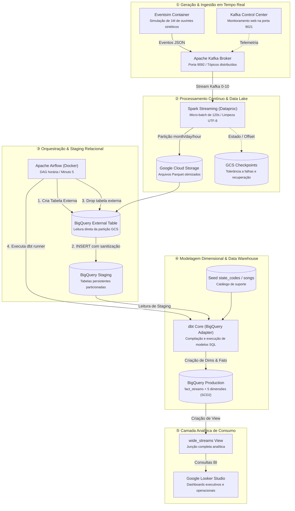
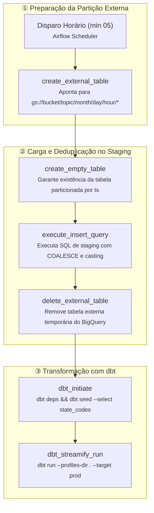
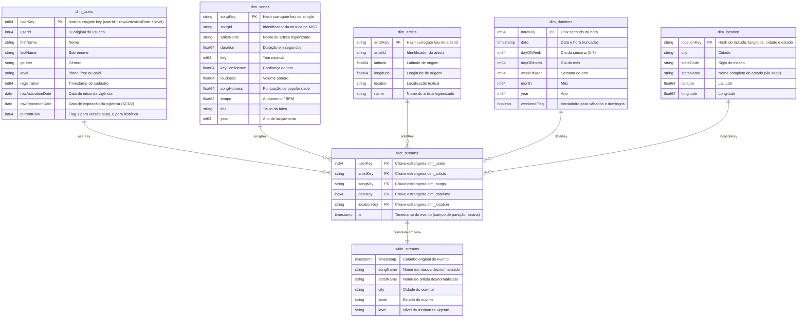

## Resumo executivo

O **Streamify** é uma plataforma analítica ponta a ponta projetada para ingestão contínua em tempo real, persistência em *data lake* e transformação dimensional de eventos simulados de um serviço de streaming de música (reproduzindo o comportamento operacional de plataformas como Spotify).

A solução resolve o desafio de capturar fluxos desestruturados de alta taxa de emissão (comportamento de escuta, navegação e autenticação de usuários), estabilizar sua ingestão em arquivos colunares no armazenamento em nuvem e alimentar um *Data Warehouse* analítico em ciclos horários previsíveis para consumo gerencial e tomadas de decisão de produto.

<div class="cards">
  <div class="card">
    <h3>Para quem foi desenhado?</h3>
    <p>Engenheiros de dados, analistas de *business intelligence* e gestores de produto que necessitam de métricas consolidadas sobre popularidade de artistas, engajamento por faixa horária, retenção de usuários e conversão entre planos gratuitos e pagos.</p>
  </div>
  <div class="card">
    <h3>O que a solução entrega?</h3>
    <p>Um modelo dimensional em estrela (*Star Schema*) no Google BigQuery com histórico temporal (SCD Tipo 2), consultas aceleradas por particionamento horário e uma visão analítica desnormalizada (*wide view*) pronta para *dashboards* executivos no Looker Studio.</p>
  </div>
  <div class="card">
    <h3>Como os dados são processados?</h3>
    <p>Ingestão distribuída via Apache Kafka, processamento contínuo em *micro-batches* de 2 minutos pelo Apache Spark Streaming gravando no Google Cloud Storage, e orquestração horária pelo Apache Airflow executando modelos SQL pelo dbt.</p>
  </div>
</div>

---

## Visão funcional e escopo dos dados

O escopo do sistema abrange o ciclo de vida completo de telemetria comportamental gerada a partir de 1 milhão de usuários simulados consumindo um catálogo musical baseado no *Million Song Dataset* (amostra representativa com 10.000 faixas musicais).

### Eventos de Negócio Capturados

A plataforma processa três fluxos independentes de eventos gerados sinteticamente pelo simulador **Eventsim**:

1. **Eventos de Escuta (`listen_events`)**:
   - Representam o consumo efetivo de conteúdo sonoro por um usuário.
   - Contêm metadados da faixa (`song`, `artist`, `duration`), contexto da sessão (`sessionId`, `itemInSession`, `auth`, `level`), localização geográfica aproximada (`city`, `state`, `lat`, `lon`) e identificadores do usuário (`userId`, `gender`, `registration`).
2. **Eventos de Navegação (`page_view_events`)**:
   - Registram a interação de interface do usuário nas telas do serviço (`Home`, `NextSong`, `About`, `Help`, `Upgrade`, `Settings`).
   - Fornecem rastreabilidade de requisições HTTP (`method`, `status`) e associação à faixa tocada quando em tela de reprodução.
3. **Eventos de Autenticação (`auth_events`)**:
   - Registram tentativas de login e controle de acesso (`success`, `level`, `registration`).
   - Permitem auditoria de segurança e segmentação de usuários conforme status de assinatura (*free* versus *paid*).

### Dados de Referência e Catálogo

Além dos eventos dinâmicos em tempo real, a solução incorpora fontes estáticas essenciais para enriquecimento semântico:

- **Catálogo de Músicas (`songs.csv`)**: Arquivo de 10.000 músicas contendo `song_id`, `artist_name`, `artist_location`, `title`, `year`, `tempo`, `duration`, `loudness` e confiança tonal.
- **Códigos e Estados Norte-Americanos (`state_codes.csv`)**: Mapeamento oficial de siglas de estados (`stateCode`) para seus respectivos nomes por extenso (`stateName`), carregado como *seed* pelo dbt.

> [!NOTE]
> Os dados trafegados são gerados de forma sintética pelo utilitário Eventsim. Não há conexão com APIs proprietárias de streaming comercial nem transmissão de áudio binário real (apenas metadados e telemetria de eventos).

---

## Arquitetura e desenho da solução

A arquitetura do Streamify adota o padrão híbrido *Lambda / Kappa-lite*: streaming contínuo em alta vazão para redução do *buffer* operacional no armazenamento em nuvem e processamento em lote horário para transformações dimensionais determinísticas e enriquecimento semântico.



<div class="figure-legend">
  <span class="legend-item"><span class="legend-badge legend-async"></span> Ingestão Streaming Contínua</span>
  <span class="legend-item"><span class="legend-badge legend-storage"></span> Camada de Persistência / Storage</span>
  <span class="legend-item"><span class="legend-badge legend-sync"></span> Carga em Lote / Orquestração SQL</span>
</div>

### Componentes Principais da Arquitetura

1. **Eventsim na VM Kafka**: Aplicação Java que simula ações realistas de navegação e reprodução de 1 milhão de clientes virtuais e posta registros JSON em tópicos específicos.
2. **Cluster Confluent Kafka**: Orquestrado por Docker Compose, provê os tópicos `listen_events`, `page_view_events` e `auth_events`.
3. **Google Cloud Dataproc (Apache Spark)**: Cluster gerenciado Spark executando tarefas de streaming estruturado, decodificação de texto e particionamento temporal em formato Parquet no GCS.
4. **Google Cloud Storage (GCS)**: *Data Lake* estruturado que atua como repositório intermediário imutável com ciclo de vida automático.
5. **Apache Airflow**: Orquestrador baseado em DAGs responsáveis pela sincronização horária entre o GCS e o Data Warehouse.
6. **dbt (data build tool)**: Framework de engenharia de análise responsável por compilar e materializar dimensões, fatos e visões analíticas no BigQuery.
7. **Google BigQuery**: *Data Warehouse* corporativo com suporte a particionamento horário e armazenamento analítico colunar.

---

## Esteira de ingestão e processamento contínuo

A esteira de processamento contínuo opera de forma distribuída para garantir consumo imediato das mensagens produzidas e sua conversão em arquivos Parquet de alta densidade.

### Tópicos Kafka e Configuração de Broker

O arquivo `kafka/docker-compose.yml` instancia o ecossistema Confluent Kafka contendo:
- `zookeeper`: Coordena os metadados do broker na porta `2181`.
- `broker`: Conector Kafka ouvindo internamente em `29092` e externamente em `${KAFKA_ADDRESS}:9092`.
- `schema-registry`: Registro de esquemas na porta `8081`.
- `control-center`: Interface visual operacional na porta `9021`.

### PySpark Structured Streaming

O script `spark_streaming/stream_all_events.py` consome os tópicos simultaneamente através da API Structured Streaming:

```python
# Inicialização da leitura streaming Kafka
listen_events = create_kafka_read_stream(spark, KAFKA_ADDRESS, KAFKA_PORT, "listen_events")
listen_events = process_stream(listen_events, schema["listen_events"], "listen_events")

# Escrita particionada com trigger de 120 segundos
listen_events_writer = create_file_write_stream(
    listen_events,
    f"{GCS_STORAGE_PATH}/listen_events",
    f"{GCS_STORAGE_PATH}/checkpoint/listen_events"
)
```

### Tratamento e Decodificação de Strings (UDF)

Para contornar inconsistências de codificação octal e sequências de escape geradas pelo Eventsim nos nomes de músicas e artistas, o módulo `spark_streaming/streaming_functions.py` aplica uma função definida pelo usuário (UDF) em nível de linha:

```python
@udf
def string_decode(s, encoding='utf-8'):
    if s:
        return (s.encode('latin1')
                .decode('unicode-escape')
                .encode('latin1')
                .decode(encoding)
                .strip('\"'))
    return s
```

### Estrutura de Particionamento no Data Lake

O Spark Streaming particiona os arquivos Parquet de forma determinística:
- Estrutura de diretórios: `gs://<bucket>/<topic>/month=<M>/day=<D>/hour=<H>/`
- Intervalo de disparo (*trigger*): **120 segundos** (`trigger(processingTime="120 seconds")`).
- Modo de escrita: `append` com *checkpoints* preservados em `gs://<bucket>/checkpoint/<topic>`.

---

## Orquestração em lote e cargas no Airflow

O Apache Airflow é responsável pela ingestão periódica das partições horárias do Data Lake para o BigQuery e subsequente modelagem analítica com o dbt.

### DAG de Carga Inicial (`load_songs_dag`)

A DAG `load_songs_dag` executa uma única vez (`schedule_interval="@once"`) para popular o catálogo musical estático:

1. Realiza download do arquivo `songs.csv` do repositório remoto via `curl`.
2. Converte o arquivo para o formato Parquet utilizando `pyarrow.csv` e `pyarrow.parquet`.
3. Faz upload do Parquet gerado para `gs://<bucket>/songs/songs.parquet`.
4. Remove os arquivos temporários locais do container.
5. Cria a tabela externa permanente `songs` no dataset de staging do BigQuery (`streamify_stg.songs`).

### DAG Horária Principal (`streamify_dag`)

A DAG `streamify_dag` é agendada para o minuto 5 de cada hora (`schedule_interval="5 * * * *"`), garantindo que todos os micro-batches do Spark da hora fechada já tenham sido descarregados no GCS.



<div class="figure-legend">
  <span class="legend-item"><span class="legend-badge legend-sync"></span> Operador BigQuery / Tarefa Airflow</span>
  <span class="legend-item"><span class="legend-badge legend-storage"></span> Tabela Particionada Staging</span>
</div>

### Idempotência e Tratamento em SQL

A query executada em cada ciclo insere dados tratados com valores padrão explícitos:
- Tratamento de nulos em strings com `COALESCE(campo, 'NA')`.
- Tratamento de identificadores numéricos com `COALESCE(userId, 0)`.
- Datas de registro padrão `COALESCE(registration, 9999999999999)`.
- Duração com fallback de `-1`.

---

## Modelo dimensional e relacionamentos

O Data Warehouse utiliza a modelagem dimensional em estrela (*Star Schema*) no dataset `streamify_prod`, dividindo fatos transacionais e entidades de dimensão para simplificar consultas e acelerar agregações analíticas.



### Características das Tabelas Dimensionais

- **`dim_users` (SCD Tipo 2)**: Rastreia a mudança de categoria dos usuários entre contas gratuitas (`free`) e pagas (`paid`). Cria registros adicionais com intervalo de vigência (`rowActivationDate` a `rowExpirationDate`) e sinalizador `currentRow`.
- **`dim_songs` & `dim_artists`**: Incluem registros fictícios universais (`NNNNNNNNNNNNNNNNNNN` / `NA`) garantindo integridade referencial (*referential integrity*) caso o evento aponte para faixas ausentes do catálogo.
- **`dim_datetime`**: Tabela de tempo pré-calculada contendo granularidade horária de 01/10/2018 a 01/01/2023, enriquecida com metadados de calendário (`weekendFlag`, `weekOfYear`).
- **`dim_location`**: Desduplica localizações baseadas na combinação de latitude, longitude, cidade e estado, enriquecendo o registro com a descrição completa via tabela de apoio `state_codes`.
- **`fact_streams`**: Tabela centralizada contendo as chaves substitutas (*surrogate keys*) e o carimbo de data/hora (`ts`). É particionada no BigQuery por hora (`granularity: hour`), otimizando custos e tempos de varredura.
- **`wide_streams`**: Visão SQL calculada (`materialized = 'view'`) que junta todas as dimensões com a fato, pronta para alimentação dos painéis analíticos do Google Looker Studio.

---

## Regras de negócio, transformações e qualidade

As regras de negócio garantem a consistência e a resiliência dos dados transformados frente a falhas de rede, caracteres corrompidos e eventos fora de ordem.

### 1. Rastreamento Histórico de Usuários (SCD Tipo 2)

A evolução do perfil de assinatura do usuário é mapeada através de funções de janela analíticas em SQL (`LAG`, `LEAD`, `SUM` cumulativo e `RANK`):

1. **Detecção de Mudança**: Compara o campo `level` atual com a linha anterior via `LAG(level, 1, 'NA')`. Quando há divergência, marca o indicador `lagged = 1`.
2. **Agrupamento Sequencial**: Calcula `SUM(lagged) OVER (PARTITION BY userId ... ORDER BY date)` gerando um identificador de bloco de versão (`grouped`).
3. **Determinação de Validade**: A data de expiração (`rowExpirationDate`) da versão atual recebe a data inicial (`minDate`) da próxima versão através de `LEAD(minDate, 1, '9999-12-31')`.
4. **Linha Vigente**: Atribui `currentRow = 1` à versão de maior data usando `RANK() OVER (ORDER BY grouped DESC)`.

### 2. Normalização e Higienização de Textos

Devido a problemas de formatação em strings que contêm aspas duplas e barras invertidas de escape nos arquivos JSON originais, tanto a camada Spark quanto a camada dbt aplicam higienização estrita:

$$\text{artistName} = \operatorname{REPLACE}(\operatorname{REPLACE}(\text{artist\_name}, \text{'"'}, \text{''}), \text{'\\'}, \text{''})$$

### 3. Matriz de Tratamento de Nulos e Fallback

| Campo | Tabela de Origem | Regra de Sanitização / Fallback | Significado de Negócio |
|---|---|---|---|
| `artist` | `listen_events` | `COALESCE(artist, 'NA')` | Evento sem identificação textual de artista |
| `song` | `listen_events` | `COALESCE(song, 'NA')` | Faixa sonora não identificada |
| `duration` | `listen_events` | `COALESCE(duration, -1)` | Duração indisponível (código sentinela `-1`) |
| `userId` | Todas | `COALESCE(userId, 0)` | Usuário não autenticado ou convidado anônimo |
| `registration` | Todas | `COALESCE(registration, 9999999999999)` | Data de cadastro inexistente ou desconhecida |
| `success` | `auth_events` | `COALESCE(success, FALSE)` | Falha de autenticação assumida por omissão |
| `stateName` | `dim_location` | `COALESCE(state_codes.stateName, 'NA')` | Código de estado fora da federação catalogada |

---

## Parâmetros temporais e políticas operacionais

A sincronização entre o processamento contínuo em *streaming* e as esteiras em lote requer o alinhamento de janelas temporais de execução, tolerâncias a atrasos e políticas de retenção.

### Latências e Intervalos Operacionais

```chart
{
  "type": "bar",
  "title": "Latência e janelas de processamento",
  "unit": "segundos",
  "source": "spark_streaming/stream_all_events.py e airflow/dags/streamify_dag.py",
  "data": [
    {"label": "Trigger Spark Streaming (Micro-batch)", "value": 120, "variant": "accent"},
    {"label": "Intervalo DAG Airflow (Horário)", "value": 3600, "variant": "warning"},
    {"label": "Timeout de Carga BigQuery", "value": 300, "variant": "neutral"},
    {"label": "Delay de inicialização Kafka", "value": 0, "variant": "success"}
  ]
}
```

### Políticas de Retenção e Ciclo de Vida

```chart
{
  "type": "bar",
  "title": "Políticas de retenção configuradas",
  "unit": "dias",
  "source": "terraform/main.tf e dbt/models/core/dim_datetime.sql",
  "data": [
    {"label": "Expiração de Objetos no Bucket GCS", "value": 30, "variant": "warning"},
    {"label": "Horizonte de Datas dim_datetime", "value": 1553, "variant": "accent"},
    {"label": "Expiração Padrão BigQuery (Ilimitado)", "value": 0, "variant": "neutral"}
  ]
}
```

> [!TIP]
> O ciclo de vida configurado no Terraform para o bucket GCS exclui arquivos com mais de 30 dias de idade (`age = 30`), economizando custos de armazenamento em nuvem enquanto o histórico analítico permanece preservado permanentemente nas tabelas particionadas do BigQuery.

---

## Infraestrutura como código com Terraform

Toda a infraestrutura em nuvem na Google Cloud Platform é declarada e automatizada via Terraform no diretório `terraform/`.

### Recursos Provisionados

- **`google_compute_instance.kafka_vm_instance`**:
  - Máquina `e2-standard-4` (4 vCPUs, 16 GB de RAM) executando Ubuntu 20.04 LTS.
  - Hospeda os containers Docker do ecossistema Kafka e o gerador de eventos Eventsim.
- **`google_compute_instance.airflow_vm_instance`**:
  - Máquina `e2-standard-4` (4 vCPUs, 16 GB de RAM) executando Ubuntu 20.04 LTS.
  - Hospeda a stack do Airflow e a instalação do dbt.
- **`google_dataproc_cluster.mulitnode_spark_cluster`**:
  - Cluster Spark gerenciado composto por 1 nó Master (`e2-standard-2`) e 2 nós Workers (`e2-medium`).
  - Imagem base `2.0-debian10` com suporte opcional a Jupyter Notebooks.
- **`google_storage_bucket.bucket`**:
  - Bucket com *Uniform Bucket-Level Access* e regra de ciclo de vida para expurgo automático após 30 dias.
- **`google_bigquery_dataset.stg_dataset` & `prod_dataset`**:
  - Datasets analíticos `streamify_stg` e `streamify_prod` na região configurada.
- **`google_compute_firewall.port_rules`**:
  - Regra de firewall liberando a porta `9092` na VM do Kafka para comunicação direta do cluster Dataproc.

<details>
<summary>Visualizar parâmetros configuráveis (variables.tf)</summary>

```hcl
variable "project" {
  description = "Your GCP Project ID"
  type        = string
}

variable "region" {
  description = "Your project region"
  default     = "us-central1"
  type        = string
}

variable "zone" {
  description = "Your project zone"
  default     = "us-central1-a"
  type        = string
}

variable "stg_bq_dataset" {
  default     = "streamify_stg"
  type        = string
}

variable "prod_bq_dataset" {
  default     = "streamify_prod"
  type        = string
}
```

</details>

---

## Guia de operação e procedimentos de execução

A operação do Streamify requer uma sequência rigorosa de inicialização das camadas para evitar falhas de comunicação e nós desconectados.

### Ordem Estrita de Execução

1. **Provisionamento da Infraestrutura (Terraform)**:
   ```bash
   cd terraform
   terraform init
   terraform plan
   terraform apply
   ```
2. **Inicialização do Broker Kafka e Ferramentas**:
   - Conecte via SSH na VM `streamify-kafka`.
   - Defina o IP externo da máquina: `export KAFKA_ADDRESS=$(curl -s ifconfig.me)`
   - Suba os containers:
     ```bash
     cd ~/streamify/kafka
     docker-compose build && docker-compose up -d
     ```
   - Valide se o Kafka Control Center está ativo na porta `9021`.
3. **Disparo da Simulação (Eventsim)**:
   - Na mesma VM do Kafka, dispare o gerador de eventos em segundo plano:
     ```bash
     bash ~/streamify/scripts/eventsim_startup.sh
     docker logs --follow million_events
     ```
4. **Submissão do Job Spark Streaming**:
   - Conecte via SSH no nó master do Dataproc (`streamify-spark`).
   - Configure as variáveis de ambiente:
     ```bash
     export KAFKA_ADDRESS=<IP_EXTERNO_KAFKA>
     export GCP_GCS_BUCKET=<NOME_DO_BUCKET>
     ```
   - Execute o script Spark:
     ```bash
     spark-submit \
       --packages org.apache.spark:spark-sql-kafka-0-10_2.12:3.1.2 \
       stream_all_events.py
     ```
5. **Configuração e Inicialização do Airflow**:
   - Conecte via SSH na VM `streamify-airflow`.
   - Adicione o arquivo de credenciais da conta de serviço GCP em `~/.google/credentials/google_credentials.json`.
   - Exporte as variáveis de projeto e bucket e suba a stack:
     ```bash
     bash ~/streamify/scripts/airflow_startup.sh
     ```
   - No painel do Airflow (porta `8080`), ative primeiro a DAG `load_songs_dag` e, em seguida, ative a DAG `streamify_dag`.

### Diagnóstico de Problemas e Recuperação

- **Queda de Containers do Kafka (`broker` / `schema-registry`)**:
  - *Sintoma*: Porta 9021 inacessível ou broker recusando conexões.
  - *Ação*: Pare os containers com `docker-compose down` e reinicie com `docker-compose up -d`.
- **Erro de Conexão no Spark (`Connection to node -1 localhost:9092 could not be established`)**:
  - *Sintoma*: Spark não consome dados ou entra em timeout.
  - *Causa*: Variável `KAFKA_ADDRESS` não configurada na VM Kafka ou no nó master do Dataproc. O broker expôs o listener apenas para localhost.
- **Falha de Permissão no dbt dentro do Airflow**:
  - *Sintoma*: Airflow falha nas tarefas `dbt_initiate` ou `dbt_streamify_run` com erro de escrita em logs.
  - *Ação*: Conceda permissão no diretório compartilhado: `sudo chmod -R 777 dbt/`.

---

## Decisões de engenharia e limites de interpretação

### Decisões Implementadas

1. **Micro-Batch de 2 Minutos no Spark Streaming**:
   - *Justificativa*: Gravar no Cloud Storage a cada evento individual geraria milhões de arquivos minúsculos (*small files problem*), degradando o desempenho de leitura do BigQuery e aumentando custos de chamadas de API. A janela de 120 segundos equilibra frescor analítico com eficiência de compressão Parquet.
2. **SCD Tipo 2 na Dimensão de Usuários**:
   - *Justificativa*: A transição entre usuários `free` e `paid` impacta diretamente o cálculo de receita e métricas de conversão. Manter apenas o estado atual (`SCD Tipo 1`) destruiria a rastreabilidade histórica de reproduções executadas enquanto o usuário era gratuito.
3. **Tabelas Externas Temporárias no BigQuery**:
   - *Justificativa*: O Airflow cria uma tabela externa temporária apontando para a partição horária exata, executa uma carga controlada via `INSERT ... SELECT` com higienização e descarta a definição da tabela externa, evitando manter metadados obsoletos no catálogo.
4. **Isolamento de VMs Dedicadas para Kafka e Airflow**:
   - *Justificativa*: A geração intensiva de eventos pelo Eventsim e o tráfego do Kafka competem fortemente por memória e I/O. Separar os servidores evita que picos de simulação causem indisponibilidade no escalonador do Airflow.

### Limites de Interpretação e Não-Escopo

- **Simulação Fictícia**: O Eventsim reproduz distribuições probabilísticas de uso. Padrões de escuta não correspondem a usuários humanos reais nem a dados sob a LGPD/GDPR.
- **Full Refresh no dbt**: O projeto atual executa a transformação do dbt em modo completo nas tabelas dimensionais a cada hora (`materialized = 'table'`). Em um ambiente de produção em larga escala, recomenda-se migrar para modelos incrementais (`is_incremental()`).
- **Necessidade de Infraestrutura em Nuvem Ativa**: O código do repositório descreve os contratos e fluxos, mas a execução real depende de provisionamento de recursos cobrados na Google Cloud Platform.

---

## Dicionário de dados das tabelas e esquemas

<details open>
<summary>Tabela Staging: listen_events (streamify_stg.listen_events)</summary>

| Coluna | Tipo BigQuery | Descrição | Regra de Tratamento |
|---|---|---|---|
| `artist` | `STRING` | Nome do artista da faixa musical | `COALESCE(artist, 'NA')` |
| `song` | `STRING` | Título da canção reproduzida | `COALESCE(song, 'NA')` |
| `duration` | `FLOAT64` | Duração da faixa em segundos | `COALESCE(duration, -1)` |
| `ts` | `TIMESTAMP` | Momento exato em que a faixa foi tocada | Campo de partição horária |
| `auth` | `STRING` | Estado de autenticação do ouvinte | `Logged In`, `Logged Out`, etc. |
| `level` | `STRING` | Tipo de conta no momento do evento | `free` ou `paid` |
| `city` | `STRING` | Cidade do usuário | `COALESCE(city, 'NA')` |
| `state` | `STRING` | Sigla do estado norte-americano | `COALESCE(state, 'NA')` |
| `userAgent` | `STRING` | Identificação do navegador/dispositivo | String original de User-Agent |
| `lon` | `FLOAT64` | Longitude aproximada do ouvinte | `COALESCE(lon, 0.0)` |
| `lat` | `FLOAT64` | Latitude aproximada do ouvinte | `COALESCE(lat, 0.0)` |
| `userId` | `INTEGER` | Identificador único do ouvinte | `COALESCE(userId, 0)` |
| `lastName` | `STRING` | Sobrenome do usuário | `COALESCE(lastName, 'NA')` |
| `firstName` | `STRING` | Primeiro nome do usuário | `COALESCE(firstName, 'NA')` |
| `gender` | `STRING` | Gênero do ouvinte | `M`, `F` ou `NA` |
| `registration` | `INTEGER` | Timestamp Unix de criação da conta | `COALESCE(registration, 9999999999999)` |

</details>

<details>
<summary>Tabela Dimensão: dim_users (streamify_prod.dim_users)</summary>

| Coluna | Tipo BigQuery | Descrição |
|---|---|---|
| `userKey` | `INTEGER` | Chave substituta gerada por hash (`userId`, `rowActivationDate`, `level`) |
| `userId` | `INTEGER` | Identificador natural do usuário |
| `firstName` | `STRING` | Primeiro nome |
| `lastName` | `STRING` | Sobrenome |
| `gender` | `STRING` | Gênero |
| `level` | `STRING` | Nível de assinatura na vigência deste registro (`free` ou `paid`) |
| `registration` | `INTEGER` | Timestamp de cadastro |
| `rowActivationDate` | `DATE` | Data de início de vigência deste registro de perfil |
| `rowExpirationDate` | `DATE` | Data de expiração deste registro de perfil (`9999-12-31` para vigente) |
| `currentRow` | `INTEGER` | Sinalizador: `1` para a versão atual do usuário, `0` para versão histórica |

</details>

<details>
<summary>Tabela Fato: fact_streams (streamify_prod.fact_streams)</summary>

| Coluna | Tipo BigQuery | Descrição |
|---|---|---|
| `userKey` | `INTEGER` | Chave estrangeira associada à `dim_users` |
| `artistKey` | `STRING` | Chave estrangeira associada à `dim_artists` |
| `songKey` | `STRING` | Chave estrangeira associada à `dim_songs` |
| `dateKey` | `INTEGER` | Chave estrangeira associada à `dim_datetime` |
| `locationKey` | `STRING` | Chave estrangeira associada à `dim_location` |
| `ts` | `TIMESTAMP` | Timestamp do evento de escuta (partição por hora da tabela) |

</details>

---

## Glossário

- **Airflow**: Plataforma de orquestração de fluxos de trabalho através de Grafos Acíclicos Dirigidos (DAGs) codificados em Python.
- **BigQuery**: Data Warehouse em nuvem totalmente gerenciado e altamente escalável da Google Cloud Platform.
- **Dataproc**: Serviço de nuvem gerenciado para execução de clusters Apache Spark e Apache Hadoop.
- **dbt (data build tool)**: Ferramenta de transformação que permite a engenheiros de dados modelar dados em SQL seguindo as melhores práticas da engenharia de software.
- **Eventsim**: Gerador de dados sintéticos baseado em eventos de acesso a páginas e consumo musical, originalmente concebido pela Interana.
- **Kafka**: Plataforma distribuída de mensageria e transmissão de eventos (*event streaming*).
- **Parquet**: Formato de armazenamento colunar de dados, aberto e otimizado para consultas analíticas complexas.
- **SCD Tipo 2 (Slowly Changing Dimension Type 2)**: Técnica de modelagem dimensional que mantém o histórico completo de alterações de atributos de uma entidade adicionando novas linhas com intervalos de vigência.
- **Star Schema (Esquema Estrela)**: Abordagem de modelagem dimensional em que uma tabela de fatos central é conectada a múltiplas tabelas de dimensão independentes.
- **Surrogate Key (Chave Substituta)**: Chave artificial primária única (geralmente numérica ou hash) criada para desvincular o modelo dimensional das chaves de negócio naturais dos sistemas de origem.
- **Wide View / Wide Table**: Tabela ou visão relacional desnormalizada que combina dimensões e fatos em uma única estrutura ampla para simplificar consultas analíticas no Looker Studio.
