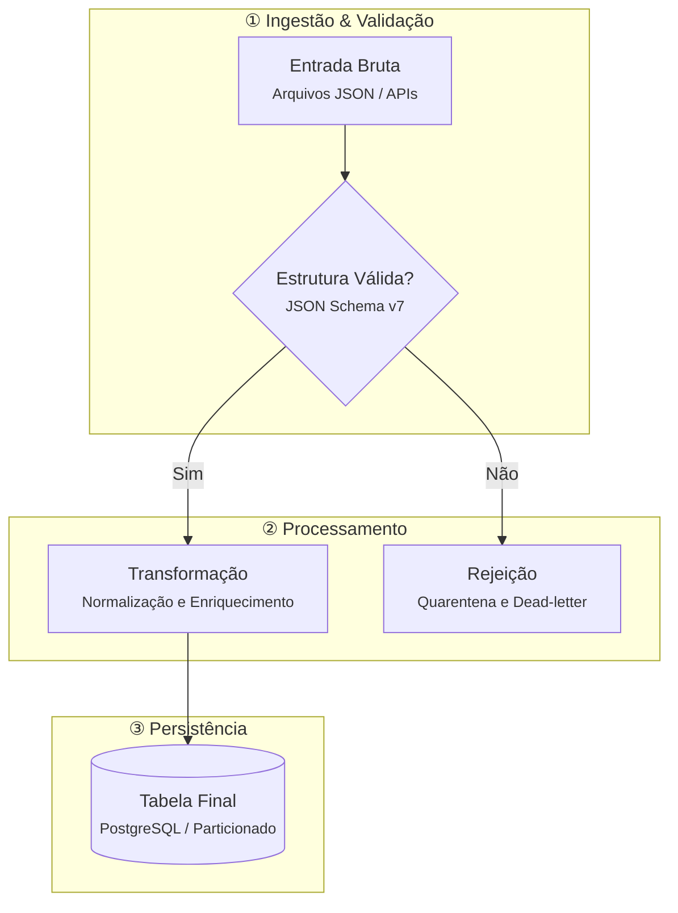

# Authoring contract

## Reader journey and source selection

| Category | Useful answer | Typical source |
|---|---|---|
| Executive summary | Problem, consumers, delivery, supported decisions | Product context, README, outputs |
| Functional scope | Inputs, outputs, concepts, boundaries | Interfaces and existing docs |
| Current state | Implemented capabilities, version, dated observations if available | Code/config; run artifacts for observations |
| How to use | Tasks, recipes, expected results, interpretation | UI, CLI/API, SQL, examples |
| Solution design | Components, boundaries, stores and consumers | Runtime, infrastructure, dependencies |
| Processing | Trigger, ordering, decisions, reads/writes, failure branches | Entrypoints and orchestration |
| Rules | Conditions, formula, exclusions and example | Code, SQL, config, relevant tests |
| Data model | Grain, identity, relations, types and meanings | DDL, models, Arrow, contracts |
| Operation | Prerequisites, parameters, execution, outputs, recovery | CLI, workflows, runbooks |
| Decisions | Current choices and established rationale | ADRs and maintained docs |
| Glossary/references | Terms and sources for deeper reading | Domain context, local paths |

Combine related categories or add project-specific sections. Do not force empty categories. Explain behavior before implementation details. Prefer useful recipes to embedding entire modules. Identify audiences without splitting the same facts into contradictory business and technical documents.

## Input format

`document.json` conforms to `schemas/document.schema.json`:

- Required: `title`, `subtitle`, `version`, `updated` (YYYY-MM-DD), `content` (relative Markdown), `sections`.
- `language`: `pt-BR` (default) or `en`.
- Each section: `id`, `title`, `audience` (`all`, `business`, `technical`, `operations`), optional `sources` IDs.
- `repoRoot`: relative repository path; `revision`: revision actually read from Git.
- `sources`: local `id`, `path` relative to repoRoot, `description`. The builder checks existence and records hashes separately. Files are not executed.
- `dataAsOf`: optional observation date/time and timezone, distinct from document update and code revision.
- `cards`: up to four objects with `label`, `value`, `description`. Prefer stable properties; measured numbers need dates.

Start Markdown with `## First section title`. Every H2 maps to a manifest section; H3/H4 are subsections. H1 is generated. Links use manifest IDs, e.g. `[Rules](#rules)`. Scripts, event handlers, iframes, inline CSS and remote assets are not authoring components. HTML is sanitized.

Cards use ordinary HTML:

```html
<div class="cards">
<div class="card"><h3>Question</h3><p>What the reader needs to know.</p></div>
</div>
```

For progressive detail, use `<details>` then `<summary>Detailed schema</summary>`, a blank line, Markdown, a blank line and `</details>`. Blockquotes become interpretation notes. Tables gain horizontal scroll; code fences gain copy controls with manual-selection fallback. References are anchors within the single HTML.

## Diagrams

````markdown

````

Use a descriptive title after `mermaid`. Supported by the pinned Beautiful Mermaid renderer: basic flowchart, state, sequence, class, ER and XY charts. Not every Mermaid feature is supported. Prefer simple nodes/edges/subgraphs; resolve parsing errors without deleting semantics.

### Diretrizes de Desenho de Solução e Arquitetura

1. **Proibição Expressa de Diagramas em Linha Reta Horizontal**:
   - É **estritamente proibido** construir diagramas de arquitetura, fluxo de processamento ou esteiras em linha reta horizontal longa (`flowchart LR` contínuo com mais de 3 nós).
   - Linhas horizontais longas causam transbordamento severo da viewport em telas padrão (desktop 1080p e mobile), obrigando rolagem horizontal cansativa e quebrando o rastreamento visual do leitor.

2. **Padrão Obrigatório: Matriz Arquitetural 2D (Entradas + Estágios Empilhados)**:
   - Diagramas de solução e fluxo devem ser organizados como uma **matriz bidimensional estruturada**:
     - **Coluna Lateral Esquerda (`ENTRADAS`)**: Fontes de dados, eventos externos, arquivos brutos ou cadastros auxiliares (`subgraph ENTRADAS ["ENTRADAS"] direction TB`).
     - **Estágio Superior (`STAGE1` ou `ESTAGIO1`)**: Processamento contínuo / tempo real / validação rápida (`direction LR` com 3 a 4 nós compactos).
     - **Estágio Inferior (`STAGE2` ou `ESTAGIO2`)**: Processamento em lote / modelagem dimensional / serving e analytics (`direction LR` com 3 a 4 nós compactos).
     - **Conexões Inter-estágios Verticais**: Setas verticais unindo os dois andares (ex.: Data Lake persistido no Estágio 1 lido pelo Staging do Estágio 2, e notificações/confirmações em linha tracejada).
   - **Aspect Ratio Ideal**: O diagrama 2D atinge proporção retangular equilibrada (~2:1 a ~3:1), eliminando a "torre vertical infinita" (`flowchart TD` ingênuo) e o "transbordamento horizontal infinito" (`flowchart LR` contínuo).
   - **Passos Numerados**: Identifique cada estágio ou nó sequencial com marcadores circulares Unicode (①, ②, ③, ④, ⑤...) no título para explicitar sem ambiguidade a ordem temporal ou de dependência.
   - **Subtítulos Descritivos com `<small>`**: Cada nó de arquitetura deve apresentar rótulo estruturado com título conciso e papel técnico em linha secundária (ex.: `node["② Ingestão Batch<br><small>Workers assíncronos e idempotentes</small>"]`).
   - **Legendas Semânticas Padronizadas (`.figure-legend`)**: Logo abaixo de diagramas com múltiplas classes de nós ou tipos de conexões, insira um contêiner `.figure-legend` com badges de cores e linhas:
     ```html
     <div class="figure-legend">
       <span class="legend-item"><span class="badge badge-danger"></span> Dados em Tempo Real / Streaming</span>
       <span class="legend-item"><span class="badge badge-info"></span> Camada Analítica / DW / Lote</span>
       <span class="legend-item"><span class="badge badge-neutral"></span> Fontes de Entrada</span>
       <span class="legend-item"><span class="line-dashed"></span> Leitura de Metadados / Gatilhos</span>
       <span class="legend-item"><span class="line-solid"></span> Fluxo Contínuo de Dados</span>
     </div>
     ```
   - **Nota Técnica de Rodapé**: Logo abaixo da legenda, adicione um parágrafo conciso com métricas reais de execução (ex.: janelas de micro-lote, horários de DAG, volumes e particionamento).

Architecture names components and boundaries; flow names actions and decisions; ER names entities, keys and established cardinalities; lineage describes transformations. Never invent foreign keys for aggregation or view derivation. Identify logical vs physical models. An overview can show essential attributes; full dictionaries belong below.

Keep short labels, meaningful groups, moderate widths/heights and explanatory captions. Break dense views into overview/detail. Enlarging a diagram is optional convenience, not a substitute for a readable main view. Inspect connector routes, text overlap and label clipping.

## Charts

The reusable chart component supports horizontal bars: finite nonnegative values, unique labels up to 45 characters, 1–40 categories. Retain relevant categories or state the selection. A table of values is always embedded. Negative values/time series need another documented build-time renderer, not reinterpretation as positive bars.

````markdown
```chart
{"type":"bar","title":"Configured retention","unit":"days","source":"config/retention.json","data":[{"label":"Raw","value":7,"variant":"warning"},{"label":"Curated","value":30,"variant":"success"},{"label":"Archive","value":0,"variant":"neutral"}]}
```
````

### Padrões do Componente `barChart`

- **Proximidade Gestáltica dos Valores**: O valor numérico não fica isolado no final de uma área vazia. Barras longas (`barWidth >= 64px`) acomodam o número internamente (alinhado à direita em texto branco); barras curtas posicionam o número logo após o término da barra, ou utilizam linha guia pontilhada discreta de alinhamento.
- **Régua de Escala e Grade (*Gridlines*)**: Renderização automática de marcações verticais discretas em 25%, 50%, 75% e 100% da escala máxima, acompanhadas dos valores correspondentes para orientar a leitura quantitativa instantânea.
- **Representação Semântica e Explícita do Zero**: Valores nulos (`d.value === 0`) são identificados explicitamente por badge ou texto suave `"0 (zero)"` no início da barra, abolindo traços ambíguos.
- **Variantes Semânticas de Cor (`variant`)**: Cada item de `spec.data[]` pode declarar a propriedade opcional `variant` para comunicação de status e criticidade:
  - `"accent"` (padrão): azul-petróleo/ciano (`#087f8c`)
  - `"warning"`: âmbar/alerta (`#d97706`)
  - `"danger"`: carmesim/crítico (`#dc2626`)
  - `"success"`: verde/sucesso (`#16a34a`)
  - `"neutral"`: ardósia/neutro (`#64748b`)
- **Acessibilidade e Tooltips Nativos**: Cada linha é estruturada em um grupo `<g class="chart-row">` contendo `<title>` SVG nativo com rótulo, valor formatado e unidade, exibindo tooltip imediato sem dependência de JavaScript e permitindo realce em `:hover` e foco por teclado.
- **Tabelas de Acessibilidade Embutidas**: A tabela de dados do `<details>` opera com largura de 100% sem forçamento de largura mínima excessiva, garantindo fluidez em dispositivos móveis.

Add `asOf` for measured observations. State percentage denominators and duration units. Configured cadence and retention are facts about implementation, not runtime performance.

## Validation and updates

The receipt verifies IDs, anchors, resource closure, accessible diagram names and source fingerprints. It does not certify cardinalities, business meaning, freshness or deployment status. Verify those while authoring; keep the checks out of the executive narrative.

`contentSections` counts content sections only; `referenceBlocks` counts the generated reference block. `skillVersion`, `builtAt` and `manifestSha256` identify the builder and inputs. `browserReviewed` stays `false` unless a separate review record is attached.

After building or updating a document, run `node <skill>/scripts/verify.mjs <work>/document.json <work>/documentacao.validation.json`. It recomputes source hashes and the Git revision and reports changed, missing or unexpected sources. Use `--strict` to fail when the document no longer matches its sources.

Inspect at desktop (~1440 px) and narrow (~390 px): global overflow, labels, local table/diagram scroll, accent-insensitive search, no-result search, links into collapsed sections, expand/collapse, copy/fallback, modal close/Escape and print with all sections. Check reading with network unavailable. Report actual verification rather than inferring browser success from structural validation.

On update compare source changes and revisit dependent sections. A changed hash alone is not proof of changed meaning. Render to the requested version and preserve the previous document unless replacement was requested.
