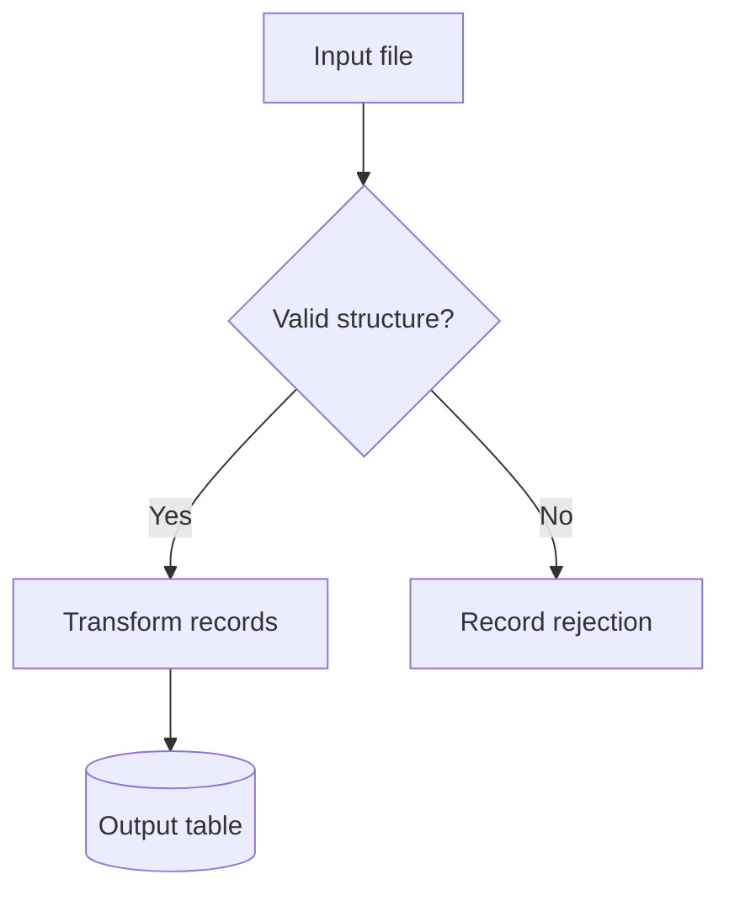

# Authoring contract

## Reader journey and source selection

| Category | Useful answer | Typical source |
|---|---|---|
| Executive summary | Problem, consumers, delivery, supported decisions | Product context, README, outputs |
| Functional scope | Inputs, outputs, concepts, boundaries | Interfaces and existing docs |
| Current state | Implemented capabilities, version, dated observations if available | Code/config; run artifacts for observations |
| How to use | Tasks, recipes, expected results, interpretation | UI, CLI/API, SQL, examples |
| Solution design | Components, boundaries, stores and consumers | Runtime, infrastructure, dependencies |
| Processing | Trigger, ordering, decisions, reads/writes, failure branches | Entrypoints and orchestration |
| Rules | Conditions, formula, exclusions and example | Code, SQL, config, relevant tests |
| Data model | Grain, identity, relations, types and meanings | DDL, models, Arrow, contracts |
| Operation | Prerequisites, parameters, execution, outputs, recovery | CLI, workflows, runbooks |
| Decisions | Current choices and established rationale | ADRs and maintained docs |
| Glossary/references | Terms and sources for deeper reading | Domain context, local paths |

Combine related categories or add project-specific sections. Do not force empty categories. Explain behavior before implementation details. Prefer useful recipes to embedding entire modules. Identify audiences without splitting the same facts into contradictory business and technical documents.

## Input format

`document.json` conforms to `schemas/document.schema.json`:

- Required: `title`, `subtitle`, `version`, `updated` (YYYY-MM-DD), `content` (relative Markdown), `sections`.
- `language`: `pt-BR` (default) or `en`.
- Each section: `id`, `title`, `audience` (`all`, `business`, `technical`, `operations`), optional `sources` IDs.
- `repoRoot`: relative repository path; `revision`: revision actually read from Git.
- `sources`: local `id`, `path` relative to repoRoot, `description`. The builder checks existence and records hashes separately. Files are not executed.
- `dataAsOf`: optional observation date/time and timezone, distinct from document update and code revision.
- `cards`: up to four objects with `label`, `value`, `description`. Prefer stable properties; measured numbers need dates.

Start Markdown with `## First section title`. Every H2 maps to a manifest section; H3/H4 are subsections. H1 is generated. Links use manifest IDs, e.g. `[Rules](#rules)`. Scripts, event handlers, iframes, inline CSS and remote assets are not authoring components. HTML is sanitized.

Cards use ordinary HTML:

```html
<div class="cards">
<div class="card"><h3>Question</h3><p>What the reader needs to know.</p></div>
</div>
```

For progressive detail, use `<details>` then `<summary>Detailed schema</summary>`, a blank line, Markdown, a blank line and `</details>`. Blockquotes become interpretation notes. Tables gain horizontal scroll; code fences gain copy controls with manual-selection fallback. References are anchors within the single HTML.

## Diagrams

````markdown

````

Use a descriptive title after `mermaid`. Supported by the pinned Beautiful Mermaid renderer: basic flowchart, state, sequence, class, ER and XY charts. Not every Mermaid feature is supported. Prefer simple nodes/edges/subgraphs; resolve parsing errors without deleting semantics.

Architecture names components and boundaries; flow names actions and decisions; ER names entities, keys and established cardinalities; lineage describes transformations. Never invent foreign keys for aggregation or view derivation. Identify logical vs physical models. An overview can show essential attributes; full dictionaries belong below.

Keep short labels, meaningful groups, moderate widths/heights and explanatory captions. Break dense views into overview/detail. Enlarging a diagram is optional convenience, not a substitute for a readable main view. Inspect connector routes, text overlap and label clipping.

## Charts

The reusable chart component supports horizontal bars: finite nonnegative values, unique labels up to 45 characters, 1–40 categories. Retain relevant categories or state the selection. A table of values is always embedded. Negative values/time series need another documented build-time renderer, not reinterpretation as positive bars.

````markdown
```chart
{"type":"bar","title":"Configured retention","unit":"days","source":"config/retention.json","data":[{"label":"Raw","value":7},{"label":"Curated","value":30}]}
```
````

Add `asOf` for measured observations. State percentage denominators and duration units. Configured cadence and retention are facts about implementation, not runtime performance.

## Validation and updates

The receipt verifies IDs, anchors, resource closure, accessible diagram names and source fingerprints. It does not certify cardinalities, business meaning, freshness or deployment status. Verify those while authoring; keep the checks out of the executive narrative.

`contentSections` counts content sections only; `referenceBlocks` counts the generated reference block. `skillVersion`, `builtAt` and `manifestSha256` identify the builder and inputs. `browserReviewed` stays `false` unless a separate review record is attached.

After building or updating a document, run `node <skill>/scripts/verify.mjs <work>/document.json <work>/documentacao.validation.json`. It recomputes source hashes and the Git revision and reports changed, missing or unexpected sources. Use `--strict` to fail when the document no longer matches its sources.

Inspect at desktop (~1440 px) and narrow (~390 px): global overflow, labels, local table/diagram scroll, accent-insensitive search, no-result search, links into collapsed sections, expand/collapse, copy/fallback, modal close/Escape and print with all sections. Check reading with network unavailable. Report actual verification rather than inferring browser success from structural validation.

On update compare source changes and revisit dependent sections. A changed hash alone is not proof of changed meaning. Render to the requested version and preserve the previous document unless replacement was requested.
